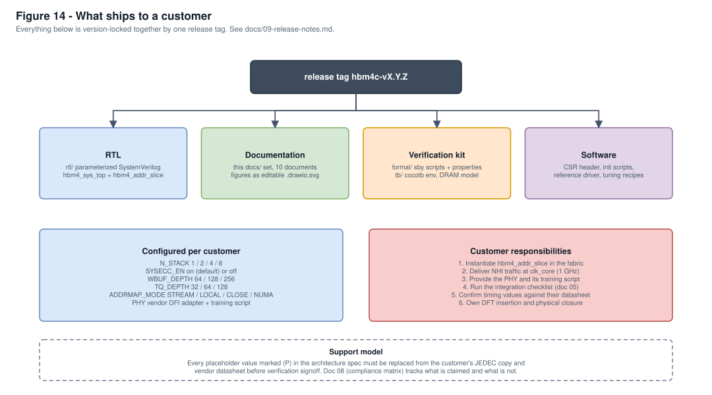

# 01 — Product Overview

**HBM4 Memory Controller IP · Rev 1.4**

A configurable, synthesizable HBM4 memory controller for bandwidth-first accelerators —
GPUs, NPUs, and tensor engines that need every byte per second the stack can deliver.

---

## 1. At a glance

| | Baseline configuration |
|---|---|
| Memory standard | JEDEC HBM4 (JESD270-4) |
| Stacks supported | 1 / 2 / 4 / 8 (`N_STACK`, baseline **4**) |
| Raw bandwidth | **8.19 TB/s** (4 stacks at 8 Gb/s/pin) |
| Achieved bandwidth, 2:1 R:W streaming | **≥ 6.80 TB/s** (83% efficiency, ECC on) |
| Raw capacity | 256 GB (16-high, 32 Gb dies) |
| Usable capacity | **240 GB** (inline ECC on) |
| Scheduling domains | 256 independent pseudo-channel controllers |
| Core clock | 1.0 GHz (DFI ratio 1:2) |
| Idle read latency | ~33 ns end to end; **10 clocks** attributable to the controller |
| Host interface | Native wide (NHI), 256 ports, synchronous |
| Data protection | Link ECC + on-die ECC visibility + inline system ECC |
| Target | ASIC, advanced FinFET |

> **Status (Rev 1.4): inline system ECC is not integrated.** `hbm4_ecc_cache` is not
> instantiated, so nothing encodes or checks stored data. The address map still reserves 2 of
> 32 columns (`div30`), so usable capacity is 240 GB as listed, but that 6.25% protects
> nothing, and no ECC column accesses are issued. Of the data protection listed, only link ECC
> is in the RTL, with retry disabled (OPEN-9). See [09 Release Notes](09-release-notes.md).

---

## 2. What it does well, and what it does not

**Built for:** long sequential streams, high row-hit potential, latency tolerated, bandwidth
paramount. Tensor traffic, activation and weight streaming, large-block DMA.

**Also handles:** mixed traffic with a latency-sensitive class (QoS with aging), moderate
irregularity (configurable XOR hashing), and random access (`CLOSE` page policy).

> **Status (Rev 1.4):** QoS aging (OPEN-11) and the `CLOSE` page policy are not implemented;
> see §3.

**Not built for:** latency-dominant CPU-like workloads with shallow memory-level parallelism.
Nothing here breaks — but a controller tuned for that would use shorter queues, a different
page policy, and would not spend 1 MB of SRAM on write buffering. If that is the target,
say so before configuring.

---

## 3. Features

> **Status (Rev 1.4): parts of this list are not in the RTL.** See
> [09 Release Notes](09-release-notes.md).
>
> - **Not integrated** (the module exists; nothing instantiates it): `hbm4_csr`, the APB
>   register block, so `hbm4_sys_top` is configured through input ports and nothing here is
>   CSR-programmable or lockable; `hbm4_ecc_cache` (inline system ECC, and with it poison);
>   `hbm4_scrub` (patrol scrub); `hbm4_err_log` (error logs); `hbm4_ecc_init` (ECC region
>   initialisation).
> - **Disabled:** link-ECC retry (OPEN-9). A link uncorrectable is reported to the host as an
>   error.
> - **Not implemented:** QoS aging and the write-age limit (OPEN-11), so starvation is not
>   bounded; address-map modes other than `STREAM`; DVFS and its double-buffered timing
>   registers; a loadable script RAM (the boot script is a ROM, `hbm4_seq_rom`); on-die ECC
>   polling, `ALERT_n` capture, PPR and lane repair.
> - **Not connected:** `hbm4_pmgr` (one per stack) tracks idle states, but its power-down,
>   self-refresh and clock-gate requests drive nothing.

**Scheduling**
- One independent scheduler core per pseudo-channel — no shared state, no cross-PC stalls
- **Dual arbiter**: row and column commands issue in the same cycle on separate buses
- Row-hit batching without a CAM (per-bank, per-row linked lists)
- Look-ahead activation targeted at `tRCD` before the column stream needs the bank
- Read/write direction batching with programmable watermarks and burst credits
- Bounded starvation at every arbitration point, with QoS aging

**Address mapping**
- Four preset maps plus a fully programmable mode
- CSR-programmable XOR hashing on stack, pseudo-channel, bank group, and bank
- Contiguous usable address space even with ECC enabled
- `HBM4_ADDR_SLICE` block shipped for the customer's fabric, formally proved equivalent to
  the controller's own decode

**RAS**
- Link ECC with bounded transparent read retry
- On-die ECC status polling and `ALERT_n` capture
- Inline system ECC: Hsiao SEC-DED(266,256), **6.25% overhead**, ECC stored in the same
  open row as its data. Single-bit correct, double-bit detect-and-never-miscorrect.
- Poison generation and propagation, patrol scrub, PPR and lane-repair flows
- Per-stack error logs with sticky first-error, aggregated globally with one timestamp

**Refresh**
- Per-bank refresh (REFsb) with opportunistic scheduling
- ±8 refresh credit slack with graded urgency
- Global refresh phase assignment across all stacks
- RFM / Directed RFM row-hammer mitigation, lockable

**Power**
- Per-pseudo-channel clock gating and DRAM power-down
- Per-stack self-refresh
- DVFS with double-buffered timing registers for atomic swap

**Init**
- Microcoded training sequencer with loadable 2 KB script RAM — training changes are a
  firmware update, not a metal spin
- Parallel training across all channels and all stacks
- Hardware ECC region initialisation

---

## 4. Configuration matrix

| Parameter | Values | Default | Effect |
|---|---|---|---|
| `N_STACK` | 1, 2, 4, 8 | 4 | bandwidth and capacity scale linearly |
| `SYSECC_EN` | 0, 1 | **1** | 6.25% of bandwidth and capacity for SDC protection |
| `WBUF_DEPTH` | 64, 128, 256 | **128** | turnaround loss 5.9% / 3.0% / 1.5% |
| `TQ_DEPTH` | 32, 64, 128 | 64 | must cover `tRC` of issue |
| `ADDRMAP_MODE` | STREAM, LOCAL, CLOSE, NUMA, RAW | STREAM | see [07-performance-guide.md](07-performance-guide.md) |
| `STACK_ILV` | FINE, MEDIUM, NUMA | FINE | bandwidth vs fault isolation |
| `ECCINIT_MODE` | FULL, LAZY | FULL | ~50 ms boot vs a more complex write path |
| `RFM_MODE` | OFF, RFM, DRFM | DRFM | row-hammer mitigation |
| `PG_GROUP` | 4, 8, 16 | 8 | power-gating granularity |

Non-power-of-two `N_STACK` (e.g. 6) is **not** expressible under `STACK_ILV = FINE`, because
the slicer is pure bit-select. Use `MEDIUM` or `NUMA`.

> **Status (Rev 1.4):** `SYSECC_EN = 1` still reserves the 2 ECC columns, but inline system
> ECC is not integrated (`hbm4_ecc_cache` is not instantiated), so it buys no SDC protection
> and costs no bandwidth. `ECCINIT_MODE` configures `hbm4_ecc_init`, which is not integrated
> either. `ADDRMAP_MODE`, `STACK_ILV`, `ECCINIT_MODE`, `RFM_MODE` and `PG_GROUP` are not RTL
> parameters; `N_STACK`, `SYSECC_EN`, `WBUF_DEPTH` and `TQ_DEPTH` are, in `hbm4_pkg`. See
> [09 Release Notes](09-release-notes.md).

---

## 5. Deliverables

| | Contents |
|---|---|
| **RTL** | Parameterised SystemVerilog. `hbm4_sys_top` (instantiate this) and `hbm4_addr_slice` (instantiate in your fabric). |
| **Documentation** | This 10-document set. Figures ship as `.drawio.svg` — they render as images and open editable in diagrams.net or the VS Code draw.io extension. |
| **Verification kit** | SymbiYosys property set and `.sby` scripts; cocotb environment, DRAM model, independent timing checker, traffic generators. Fully open-source toolchain — **no licence needed to re-verify your configuration**. |
| **Software** | CSR header, init/training scripts, reference driver, tuning recipes. |
| **Diagram sources** | `tools/gen_figures.py`, `tools/gen_waves.py` — regenerate or restyle every figure and waveform. |

> **Status (Rev 1.4): no register map.** `hbm4_csr` is not integrated, so `hbm4_sys_top` has
> no APB port and there is no CSR header to ship; configuration is through input ports. The
> repository contains no reference driver, and the boot script ships as RTL
> (`hbm4_seq_rom`). See [09 Release Notes](09-release-notes.md).

Everything is version-locked by one release tag. See
[09-release-notes.md](09-release-notes.md).

---

## 6. What you provide

| # | Responsibility | Document |
|---|---|---|
| 1 | Instantiate `HBM4_ADDR_SLICE` in your fabric | [03](03-interface-spec.md) §4 |
| 2 | Deliver NHI traffic at `clk_core` (1 GHz) | [05](05-integration-guide.md) |
| 3 | Supply the PHY and its training script | [05](05-integration-guide.md) |
| 4 | Replace every **(P)** value from your JEDEC copy and vendor datasheet | [08](08-compliance-matrix.md) |
| 5 | DFT insertion and physical closure | [05](05-integration-guide.md) |
| 6 | Run the integration checklist | [05](05-integration-guide.md) §9 |

Item 4 is not optional and not a formality. The controller ships with placeholder timing
scaled from HBM3; signing off against those proves it obeys timings that are not the ones in
your silicon.

---

## 7. Headline numbers, and where they come from

| Metric | Value | Derivation |
|---|---|---|
| Sequential read efficiency | ≥ 88% | [02](02-architecture.md) §14.1 |
| 2:1 R:W streaming efficiency | ≥ 83% | [02](02-architecture.md) §14.1 |
| Efficiency with ECC off | ≥ 89% | the ECC cost, made visible |
| Row-hit rate, ≥8 MB stream | ≥ 96% | [02](02-architecture.md) §7.5 |
| Idle read latency | ~33 ns | [02](02-architecture.md) §14.2 |
| Controller-attributable latency | 10 clocks | the rest is DRAM and PHY physics |
| Write buffer SRAM | 1 MB | 256 PC × 4 KB |
| ECC cache SRAM | 256 KB | 256 PC × 1 KB |

These are **analytic** numbers. The verification plan calls for cross-checking them against
Ramulator 2 before the RTL numbers are trusted ([06](06-verification-plan.md) §5); that
cross-check is not yet in the repository.

> **Status (Rev 1.4):** inline system ECC is not integrated (`hbm4_ecc_cache` is not
> instantiated), so the RTL has no ECC cache SRAM and issues no ECC column accesses; the ECC
> rows above describe the specified design. See [09 Release Notes](09-release-notes.md).

---

## 8. Maturity

**Rev 1.4 is implemented, and verified with the gaps stated below.** The RTL exists (31
modules and 2 packages), is lint-clean at production and reduced geometry, elaborates at full
256-pseudo-channel scale, and is covered by 42 formal proof tasks and by simulation: 12 slice
tests, 6 stack-boot tests, and 5 system-level boot and control tests at reduced geometry. Five
specified modules are not integrated (item 6 below), and the defects in items 7 and 8 are open.

What it is *not* yet: silicon-ready. See the verification status table below for the
distinction, which matters more than the revision number.

Twelve items remain open ([02](02-architecture.md) §16): eight require JESD270-4 or vendor
datasheet values, four are customer decisions. The highest-impact open item is **burst
length** — if HBM4 defines BL16/64 B rather than BL8/32 B, the column arbiter's timing
pressure eases and the ECC field width doubles. Confirm this first.

---

## Verification status at a glance

**Rev 1.4.** Stated so an evaluator does not have to reconstruct it from the release notes.

| Evidence | Status |
|---|---|
| Lint (Verilator `-Wall`) | `hbm4_sys_top` clean (0 diagnostics) at production geometry (256 slices) and at reduced geometry; 31 modules + 2 packages |
| Instantiation check | **fails**: five modules not integrated (item 6 below) |
| Formal (SymbiYosys) | 21 blocks, 42/42 proof tasks pass, 77-mutation coverage harness. 5 blocks prove modules that are not instantiated; 7 modules, including `hbm4_pc_slice`, `hbm4_stack_top` and `hbm4_sys_top`, have no proof |
| Simulation — slice | 12/12 at production geometry |
| Simulation — stack boot | 6/6 at reduced geometry |
| Simulation — system | 5/5 at reduced geometry (2 stacks, 8 slices), boot and control only; the 256-slice system has **never been simulated** |
| Synthesis | area + logic depth measured; **no signed timing** |
| Assumptions outstanding | **A10 is violated by the design** (the slice offers completions the NHI cannot take, OPEN-16). A8 is a host obligation with no shipped checker; A9 holds in simulation, unproved. A1–A3 and A7 are discharged, A4 is closed. See [formal/ASSUMPTIONS.md](../formal/ASSUMPTIONS.md) |

### What a customer must know before committing

1. **1 GHz does not currently close.** Measured against ASAP7 (predictive 7 nm, typical
   corner, no wire delay): **2334 ps** as shipped, i.e. ~428 MHz, against a 1000 ps target.
   (The earlier 1830–2252 ps figures were measured at Rev 1.1, before the write buffer and the
   write-data RAM were in the design.) The architecture's central premise — one column
   command per core clock — fails by ~2.3× as the RTL stands. It needs pipelining of
   cross-module paths, which has not been attempted. See [syn/README.md](../syn/README.md).
2. **All DRAM timing values are placeholders** marked `(P)`, pending the device datasheet.
3. **Link-ECC retry is not available** — `cfg_retry_en` must stay off. Link uncorrectables
   escalate to the host as errors. See OPEN-9.
4. **The 256-slice production system has never been simulated.** `hbm4_sys_top` is simulated
   only at reduced geometry (2 stacks × 2 channels × 2 pseudo-channels = 8 slices), and only
   for boot and control: 5/5, with no data traffic. The slice is verified at production
   geometry; the stack is simulated for boot only.
5. **The boot sequence must re-run after any reset.** Enforced structurally (`cmd_en` follows
   `boot_done`), not merely documented.
6. **Five specified features are not integrated.** `hbm4_csr` (the APB register block: no
   register map, no `AMAP_LOCK`, no `VERSION`; configure through input ports on
   `hbm4_sys_top`), `hbm4_ecc_cache` (inline system ECC: nothing encodes or checks stored data,
   yet 2 of 32 columns, 6.25% of capacity, stay reserved), `hbm4_ecc_init` (ECC
   initialisation), `hbm4_err_log` (error log) and `hbm4_scrub` (patrol scrub).
   `tools/check_instantiation.sh` fails until they are connected. See
   [09 Release Notes](09-release-notes.md).
7. **Out-of-range requests are dropped without a response.** A request whose block address
   decodes beyond capacity is never allocated and never answered, and its credit never
   returns; after `TQ_DEPTH` such requests the port has no credits left. `rsp_err = 3`
   ("access fault") is never generated. Found in Rev 1.4, not fixed.
8. **Three defects lose data or responses in normal operation.** All were found in the Rev 1.4
   review, confirmed in simulation, and not fixed. A second queued write to the same block loses
   read-after-write protection, so a read can return stale data (OPEN-15). Any `rsp_ready` stall
   that coincides with a completion loses it (OPEN-16), so the host must never stall. Write
   acknowledgements are lost under mixed read/write traffic, 14 of 213 in a production-geometry
   probe, leaking credits until the port stalls (OPEN-17). See
   [formal/ASSUMPTIONS.md](../formal/ASSUMPTIONS.md).
