# 02 — Architecture and Micro-Architecture

**HBM4 Memory Controller · Rev 1.4**

> **Status (Rev 1.4).** This document describes the intended architecture. Five of its modules
> are not instantiated in the RTL: `hbm4_csr` (the APB register block, with `AMAP_LOCK`),
> `hbm4_ecc_cache` (inline system ECC), `hbm4_ecc_init`, `hbm4_err_log` and `hbm4_scrub`. So
> there is no register map, no inline ECC on stored data, no ECC initialisation, no error log
> and no patrol scrub. Configuration that this document calls CSRs arrives, where it exists at
> all, on input ports of `hbm4_sys_top` (`tcfg`, `lcfg`, `cfg_*`, `irq_mask`). Sections whose
> features are absent or differ in the RTL carry a **Status (Rev 1.4)** note. See
> [09 Release Notes](09-release-notes.md).

---

## How to read this document

This is the "why it is built this way" document. It assumes you know digital logic and
have seen a pipeline before, but it does **not** assume you have worked on a DRAM
controller. Everything DRAM-specific is explained the first time it appears, and the
[glossary](A-glossary.md) defines every acronym.

Three conventions used throughout:

> **Why?** — boxes like this explain a design decision rather than describe a block. If you
> are skimming, read these; they carry the actual engineering content.

> ⚠️ **Common misconception** — places where the intuitive answer is wrong. These are the
> parts that catch people, including experienced engineers coming from DDR.

Values marked **(P)** are *placeholders* scaled from HBM3 and public HBM4 summaries. They
must be replaced from JESD270-4 and your vendor's datasheet before verification signoff.
Every (P) value is an RTL parameter or a CSR field — none are hardcoded. See
[§16](#16-open-items) and [08-compliance-matrix.md](08-compliance-matrix.md).

**If you are new, read in this order:** §1 (what HBM4 is) → §2 (the three constraints) →
§3 (top level) → §7 (address map) → §8 (the scheduler). Everything else is detail you can
fetch when you need it.

---

## 1. Background: what HBM4 is, and why a controller for it is hard

### 1.1 The shape of the device

A stack of DRAM dies sits next to your chip on a silicon interposer, connected by a very
wide, relatively slow bus — the opposite trade from DDR, which is narrow and fast.

| | DDR5 DIMM | HBM4 stack |
|---|---|---|
| Data width | 64 bits | **2048 bits** |
| Pin rate | ~6.4 Gb/s | ~8.0 Gb/s (P) |
| Bandwidth | ~51 GB/s | **~2048 GB/s** |
| Independent channels | 2 | **32**, each split into 2 pseudo-channels |

The 2048 bits are not one bus. They are **32 channels of 64 bits**, and each channel is
further split into **2 pseudo-channels of 32 bits**. A pseudo-channel has its own command
bus, its own bank state, and its own timing. It is a completely independent memory.

**So an HBM4 controller is not one controller. It is 64 small controllers per stack**, and
almost nothing is shared between them. That single fact drives the entire architecture.

### 1.2 DRAM in ninety seconds

If you already know ACT/PRE/RD/WR, skip to §1.3.

DRAM stores bits as charge in capacitors, arranged in a 2-D grid of **rows** and
**columns**, grouped into **banks**. You cannot read a bit directly. You must:

1. **ACT** (activate) — copy an entire row (1 KB here) into the bank's *row buffer*, a strip
   of sense amplifiers. Takes `tRCD` ≈ 14 ns (P).
2. **RD / WR** — read or write 32 bytes out of the row buffer. Fast, ~1 ns.
3. **PRE** (precharge) — write the row buffer back and prepare the bank for a different row.
   Takes `tRP` ≈ 14 ns (P).

If the next access wants the same row, you skip straight to step 2. That is a **row hit**,
and it is ~15× cheaper than a **row miss**. Maximising row hits is most of what a memory
controller does.

Two more facts that matter:

- **A bank has exactly ONE row buffer.** Only one row per bank can be open at a time. With
  32 banks per pseudo-channel you can have 32 rows open — but never two rows in one bank.
  Half the design decisions in this document trace back to this one sentence.
- **Charge leaks.** Every row must be **refreshed** every `tREFI` ≈ 3.9 µs (P) or it forgets.
  Refresh is not optional and it costs bandwidth (§9).

### 1.3 The clock plan, derived from scratch

This is worth doing slowly, because every number later depends on it.

```
  Pin data rate                            8.0 Gb/s per pin        (P)
  DQ is double-data-rate on WCK    ->      WCK = 4.0 GHz
  Command clock CK = rate / 4      ->      CK  = 2.0 GHz,  tCK = 500 ps
  DFI frequency ratio 1:2          ->      core clock = CK / 2 = 1.0 GHz
```

> **Why 1 GHz and not 2?** A "half-rate" controller could mean half of WCK (2 GHz), which
> will not close timing in a standard-cell flow at any sane area. Half of **CK** is 1 GHz,
> which is aggressive but achievable. When someone says "1:2 gearing," always ask *half of
> what*.

Now the two numbers that shape everything:

```
  One BL8 burst   =  8 UI at 8 Gb/s      =  1.0 ns  =  exactly 1 core clock
  tCCD_S          =  2 tCK               =  1.0 ns  =  exactly 1 core clock

  Per-PC bandwidth   32 pins x 8 Gb/s    =  32 GB/s
  32 bytes per core clock per pseudo-channel.
```

`BL8` is the *burst length*: one read or write moves 8 bits per pin, so 32 pins × 8 = 256
bits = **32 bytes**. That 32 B is the atom of everything in this design — the NHI request
size, the ECC block size, the write-buffer entry size.

### 1.4 System configuration (baseline)

| Parameter | Baseline | |
|---|---|---|
| `N_STACK` | 4 | 1 / 2 / 4 / 8 supported |
| Channels per stack | 32 | |
| Pseudo-channels per stack | 64 | **256 in the system** |
| Banks per PC | 32 (4 bank groups × 8) (P) | |
| Row size | 1 KB (P) | 32 columns of 32 B |
| Raw capacity | 4 × 64 GB = **256 GB** | 16-high × 32 Gb dies (P) |
| Usable capacity | **240 GB** | 15/16, with inline ECC on (§10) |
| Raw bandwidth | **8.19 TB/s** | |

---

## 2. The three constraints

Everything in this controller is a consequence of these. If you remember nothing else,
remember these three and [Timing 5](waves/wave-05-dfi-steady-state.svg).

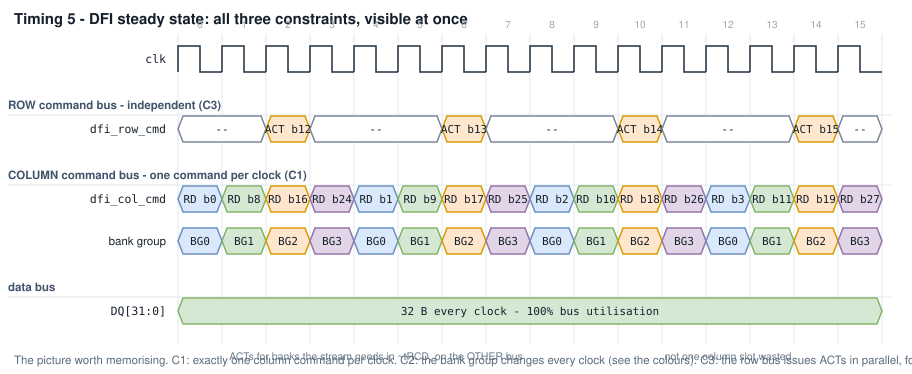

### C1 — One column command per core clock

`tCCD_S` (the minimum gap between two column commands to *different* bank groups) is 1.0 ns,
which is exactly one core clock, which is exactly one burst. So the column-command port is
**one wide**, and it is saturated in steady state.

> **Why this is brutal.** There is no slack anywhere. Every cycle the arbiter fails to issue
> a column command is 32 bytes of bandwidth that can never be recovered. At 256
> pseudo-channels, a scheduler that idles 5% of cycles costs you 400 GB/s. This is why the
> arbiter must decide *combinationally* from a precomputed mask (§8.7) and why all the
> arithmetic is pushed one pipeline stage upstream (§8.4).

### C2 — The bank group must change on every column command

There are two column-to-column timings:

| | Meaning | Value (P) |
|---|---|---|
| `tCCD_S` | next command is to a **different** bank group | 1 core clock |
| `tCCD_L` | next command is to the **same** bank group | 2 core clocks |

Hit `tCCD_L` and you lose half your bandwidth. [Timing 6](waves/wave-06-bank-group-penalty.svg)
shows exactly what that looks like.

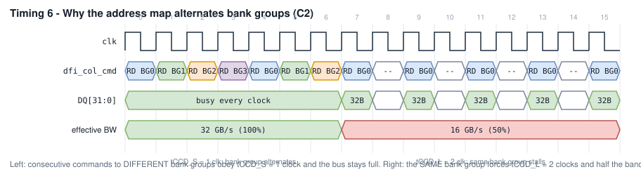

> **Why the address map, not the arbiter, solves this.** You *could* build an arbiter clever
> enough to always find a different-bank-group candidate. But it only works if such a
> candidate exists in the queue. The address map (§7) instead *guarantees* that consecutive
> accesses in a sequential stream land in different bank groups — so the natural candidate is
> already correct and the arbiter's bank-group logic is a backstop, not the mechanism.

### C3 — Row and column commands travel on separate buses

HBM3 split the per-pseudo-channel command interface into a **row bus** (ACT, PRE, REF, RFM)
and a **column bus** (RD, WR, MRS). HBM4 keeps this. They are physically separate wires.

**An ACT and a RD issue in the same cycle.** This is free parallelism that DDR does not have.

> ⚠️ **Common misconception.** Engineers coming from DDR build one arbiter that picks among
> all command types, because in DDR there is one command bus and you must choose. Doing that
> here throws away half your command bandwidth. This controller has **two independent
> arbiters** (§8.7, §8.8) that share one bank-state table and never compete.

---

## 3. Top level

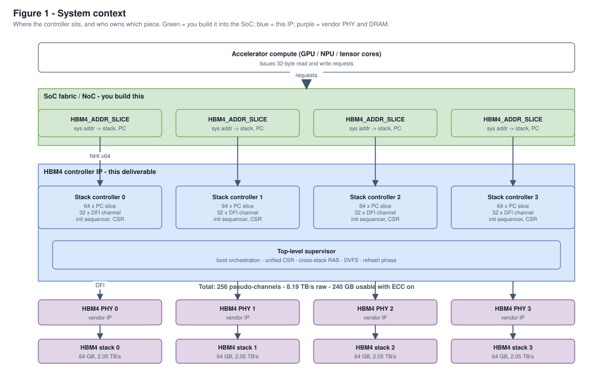

Three things are worth noticing in Figure 1.

**There is no crossbar.** 256 pseudo-channels × 32 B per clock is ~16 000 wires per
direction. A central switch at that width is not buildable at 1 GHz. Instead each
pseudo-channel gets its own port, placed physically next to its PHY slice.

**Address slicing happens in your fabric, not in the controller.** The controller ships
`HBM4_ADDR_SLICE` (§6.3) — a ~200-gate combinational block that maps a system address to
`{stack, pseudo-channel, block address}`. You instantiate it at each requester port.

> **Why push work into the customer's fabric?** Because the fabric already has to route to
> 256 destinations, and it has to know *which* destination anyway. Doing the decode twice —
> once to route, once inside the controller — would be pure duplication. The risk is that
> the two decodes disagree, which would corrupt memory silently, so the two share one RTL
> source and a formal proof (see the [verification plan](06-verification-plan.md), P-MAP-3).

**The supervisor is thin.** It handles boot, the CSR aperture, cross-stack RAS, DVFS, and
refresh phase. It is never in the data path.

> **Status (Rev 1.4):** `hbm4_supervisor` implements boot orchestration, interrupt aggregation
> and the performance-snapshot edge. There is no CSR aperture (`hbm4_csr` is not integrated)
> and no DVFS logic, and refresh phases are assigned per stack in `hbm4_stack_top`.

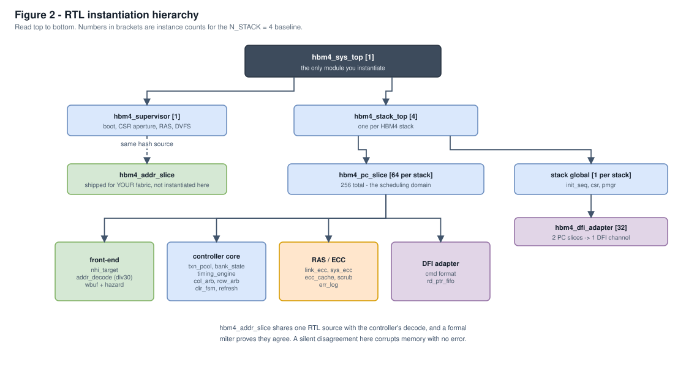

---

## 4. Clocking and reset

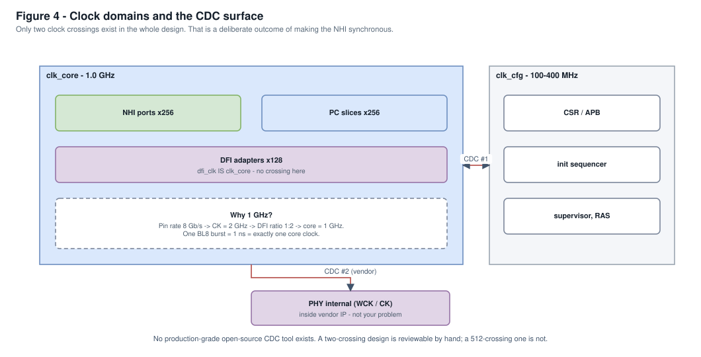

| Domain | Frequency | Contents |
|---|---|---|
| `clk_core` | 1.0 GHz (P) | **All 256 PC slices and all 256 NHI ports.** Identical to DFI `dfi_clk`. |
| `clk_cfg` | 100–400 MHz | CSR/APB, init sequencer, supervisor, RAS aggregator |

The NHI is **synchronous to `clk_core`**. Two consequences:

- ~5 ns of round-trip latency saved, and 512 dual-clock FIFOs deleted.
- **The whole design has two clock crossings**: `clk_cfg` ↔ `clk_core`, and the PHY boundary
  (inside vendor IP).

> **Why two crossings is a headline feature.** There is no production-grade open-source CDC
> analysis tool (see [06-verification-plan.md §7](06-verification-plan.md)). A design with two
> crossings can be reviewed by hand and proved with formal. A design with 514 cannot. The
> synchronous-NHI decision converted a verification problem into an integration constraint —
> **your fabric must deliver traffic at 1 GHz**, and if it cannot, *you* insert the rate
> adapter outside the controller ([05-integration-guide.md](05-integration-guide.md)).

Reset: `rst_n` (cold; async assert, sync deassert per domain) and `warm_rst_n` (retains CSR
and trained PHY state; used for DVFS and error recovery).

> **Status (Rev 1.4):** the RTL has one clock (`clk`) and one reset (`rst_n`). There is no
> `clk_cfg` domain, because there is no APB block to put in it, and no `warm_rst_n`. The init
> sequencer, supervisor and RAS logic run on the core clock, so the only clock crossing is the
> PHY boundary.

---

## 5. Capacity arithmetic

Worth doing once explicitly, because the bit budget is easy to get wrong.

```
  Stack             16 dies x 32 Gb   = 512 Gb = 64 GB
  Pseudo-channel    64 GB / 64        = 1 GB   = 2^30 bytes = 2^25 blocks of 32 B
  Bank              1 GB / 32 banks   = 32 MB
  Rows per bank     32 MB / 1 KB      = 32768                -> 15 bits
  Columns per row   1 KB / 32 B       = 32                   ->  5 bits
```

Per-PC **block**-address bit budget (the byte offset is not part of it):

```
  ROW + SID + BG + BA + COL  =  25
   15  +  0  +  2 +  3 +  5  =  25   ✓
```

`SID` (stack ID) selects among die groups in a 12-/16-high stack; it trades against `ROW`
depending on how your vendor distributes channels across dies. The **sum is invariant**.

> **Errata.** Rev 0.1 of this document stated `ROW + SID + 5 + 5 = 30`, which omitted the 5
> bank bits and double-counted the byte offset. Corrected in Rev 0.2. If you have a copy of
> Rev 0.1, discard the §5 arithmetic.

With inline ECC on, 2 of the 32 columns are reserved (§10.3):

```
  Data columns per row   30
  Usable per PC          32 banks x 32768 rows x 30 cols x 32 B  =  960 MB   (15/16)
  Usable system          240 GB, contiguous from address 0
```

---

## 6. The host interface (NHI)

Full signal-level detail is in [03-interface-spec.md](03-interface-spec.md). Here is the
shape and the reasoning.

### 6.1 What it is

A tagged, credit-metered, out-of-order request/response interface at exactly the DRAM
access granularity (32 B). One port per pseudo-channel; port *i* is hardwired to PC *i*.

There is **no** burst descriptor, no ID-ordering matrix, no exclusive access, no protocol
state machine, and no `ready` on the request channel.

> **Why not AXI?** Every feature AXI adds here is either unused by a streaming accelerator or
> better placed in the fabric. AXI's ID-ordering rules in particular would force a reorder
> buffer per port — 256 of them — to provide an ordering guarantee that tensor traffic does
> not want. If you need AXI at the SoC boundary, bridge it in the fabric where you can share
> one bridge across many pseudo-channels.

### 6.2 The three rules a host must obey

1. **Send only while you hold a credit.** Credits start at `TQ_DEPTH` and return one per
   response the host accepts. A credit *is* the permission to send; there is no ready handshake.
   ([Timing 4](waves/wave-04-nhi-credit.svg))
2. **Key on the tag, never on arrival order.** Responses come back out of order.
   ([Timing 2](waves/wave-02-nhi-out-of-order.svg))
3. **Do not stall `rsp_ready` for long.** Back-pressure here propagates all the way to the
   DRAM bus. Exceeding `RSP_STALL_MAX` raises an interrupt.

> **Status (Rev 1.4):** write data travels with its request on `req_data`.
> [03 §1](03-interface-spec.md) says exactly what the RTL implements. Write data is stored per
> transaction (by pool entry), so tags need to be unique only among outstanding reads (rule H2).
> **Rule 3 is stricter in the RTL than written:** back-pressure does not propagate. Any
> `rsp_ready` stall that coincides with a completion loses it, so do not stall at all (OPEN-16 in
> [formal/ASSUMPTIONS.md](../formal/ASSUMPTIONS.md)).

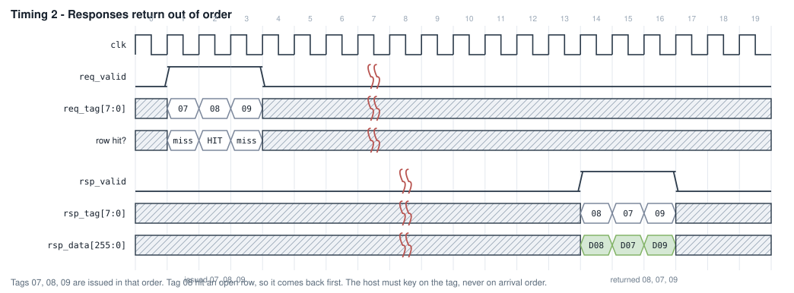

### 6.3 `HBM4_ADDR_SLICE`

```
  input  [37:0] sys_addr      // byte address, 0 .. 240 GB usable
  input         cfg_*         // mirrored CSR image (hash masks, mode)
  output [ 1:0] stack_id
  output [ 5:0] pc_id
  output [24:0] pc_blk        // PC-local block address -> becomes req_blk
```

Pure bit-select plus XOR reduction. **No arithmetic, no divide** — the divide that inline
ECC needs (§7.3) lives in the controller, where there are 256 instances, not in the slicer,
which you replicate at every requester port.

---

## 7. Address mapping

This is the highest-leverage part of the design. A wrong address map cannot be recovered by
any amount of scheduler cleverness.

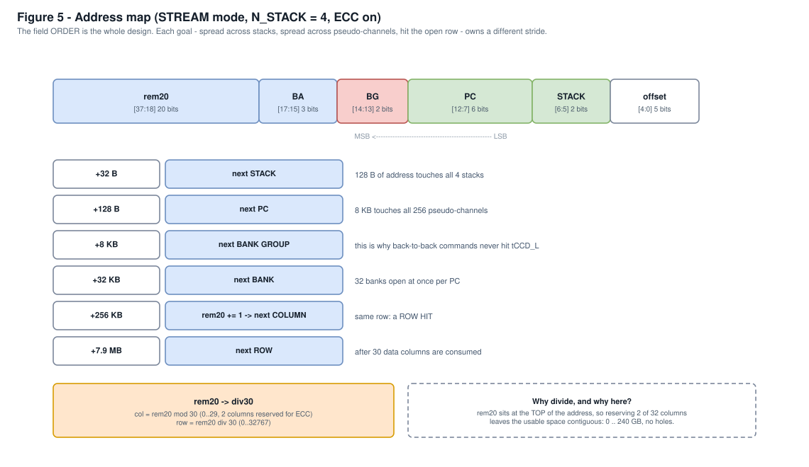

### 7.1 Three goals that look incompatible

- **Spread across stacks** — or you cap at one stack's 2 TB/s.
- **Spread across pseudo-channels** — or you cap at one PC's 32 GB/s.
- **Concentrate within a pseudo-channel** — hit the open row, alternate bank groups (C2).

They look contradictory: the first two say "scatter," the third says "gather." They are
reconcilable because **they operate at different address strides**. Order the fields
*stack → PC → BG → BA → column → row*, ascending, and each goal gets a stride of its own.

### 7.2 The baseline map

```
  bit:      37 .............. 18    17..15   14..13   12..7    6..5     4..0
        +--------------------------+--------+--------+--------+--------+-------+
        |         rem20            |   BA   |   BG   |   PC   | STACK  |offset |
        +--------------------------+--------+--------+--------+--------+-------+
                   20 bits            3        2        6        2        5

        col = rem20 mod 30      row = rem20 div 30
```

| Stride | What changes | Why it matters |
|---|---|---|
| +32 B | next **stack** | 128 B touches all 4 |
| +128 B | next **pseudo-channel** | 8 KB touches all 256 |
| +8 KB | next **bank group** | this is C2, solved by construction |
| +32 KB | next **bank** | 32 banks open per PC |
| +256 KB | next **column**, same row | a **row hit** |
| +7.9 MB | next **row** | after 30 data columns are used |

Work through the third row, because it is the clever bit. Two consecutive accesses to *the
same pseudo-channel of the same stack* are 8 KB apart in system address — because you have
to step past all 4 stacks and all 64 PCs first. 8 KB is `2^13`, and bit 13 is `BG[0]`. So it
**toggles**. Consecutive commands to one pseudo-channel automatically alternate bank groups.
C2 is satisfied without the arbiter doing anything.

### 7.3 The divide by 30

Inline ECC reserves 2 of the 32 columns (§10.3), so a row holds 30 data columns:

```
  rem20[19:0]  ->  row = rem20 / 30      col = rem20 - row*30
```

30 is not a power of two, so this is a real divide — implemented as a constant reciprocal
multiply (roughly a 20×17 multiply plus adders), one pipeline stage, absorbed into the E1
decode stage and off the arbitration critical path.

> **Why put the non-power-of-two field *there*?** Because `rem20` sits at the **top** of the
> address. Its legal range is `0 .. 32768×30−1 = 983 039` out of `2^20 = 1 048 576`, so the
> usable address space is exactly the bottom `240 GB` — **contiguous, no holes**. Reserve
> two *bits* anywhere lower and the reserved space becomes swiss cheese scattered through
> the address map, which no allocator can use. This is the entire reason for the divide.

With `ECC_EN = 0` the divide is bypassed: `col = addr[22:18]`, `row = addr[37:23]`, pure
bit-select, 256 GB usable.

### 7.4 The XOR hash (do not skip this)

A raw bit-slice map is catastrophic under power-of-two strides. An 8 KB stride — extremely
common in tensor tiling — sends **every single access to one pseudo-channel of one stack**.
You would measure 32 GB/s on an 8 TB/s machine.

So `STACK`, `PC`, `BG`, `BA` are each XOR-folded from higher address bits through
CSR-programmed masks:

```
  stack_id[i] = addr[5+i]   ^ ^(H_ST[i] & addr[37:5])     // in HBM4_ADDR_SLICE
  pc_id[i]    = addr[7+i]   ^ ^(H_PC[i] & addr[37:5])     // in HBM4_ADDR_SLICE
  bg_id[i]    = pc_blk[i]   ^ ^(H_BG[i] & pc_blk[24:0])   // in the controller
  ba_id[i]    = pc_blk[2+i] ^ ^(H_BA[i] & pc_blk[24:0])   // in the controller
```

13 masks total. Defaults fold at 256 KB, 8 MB, and 256 MB strides, which breaks the common
tiling strides while leaving short sequential runs identical to §7.2.

**`rem20` is never hashed.** Hashing it would scramble row and column and destroy every row
hit. Tuning guidance for real workloads is in
[07-performance-guide.md](07-performance-guide.md).

### 7.5 Does it actually produce row hits?

Follow one pseudo-channel through a long sequential stream:

- Accesses 1–32 walk all 4 bank groups × 8 banks — 32 distinct banks, **all row misses**.
  These ACTs are rate-limited by `tFAW` (max 4 activates per ~14 ns (P)), so the ramp takes
  ~112 ns. It happens on the *row* bus, overlapped with column traffic (C3).
- Accesses 33 onward hit those 32 open rows, one column at a time.
- A row is exhausted after 30 data columns. Per PC that is `30 × 32 = 960` accesses = 30 KB,
  spanning 7.9 MB of system address.

**Steady-state row-miss rate = 32/960 = 3.3%**, and every miss is to a bank that is not
currently streaming, so its ACT hides behind column traffic. Target ≥96% row hits, met.

### 7.6 Other modes

| Mode | Change | When |
|---|---|---|
| `STREAM` | §7.2 | default, bandwidth-first |
| `LOCAL` | PC/STACK bits above BG/BA | small working sets, latency-critical scalar traffic |
| `CLOSE` | auto-precharge every access | genuinely random access; frees the row bus |
| `NUMA` | STACK at the top, contiguous per-stack regions | software placement; heterogeneous or degraded stacks (§13.4) |
| `RAW` | fully CSR-programmable | bring-up and silicon debug |

> **Status (Rev 1.4):** only `STREAM` is implemented. The RTL has no mode field:
> `hbm4_addr_slice` and `hbm4_addr_decode` take hash masks only (`slice_cfg_t`, `local_cfg_t`),
> and no column command auto-precharges. `LOCAL`, `CLOSE`, `NUMA` and `RAW` do not exist.

---

## 8. The controller core

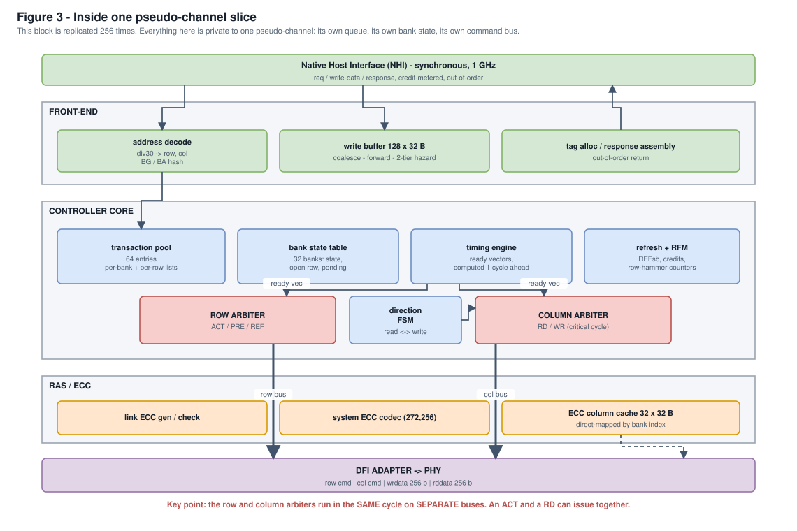

### 8.1 Pipeline

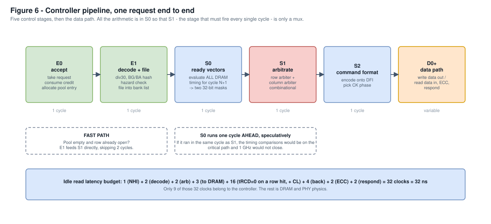

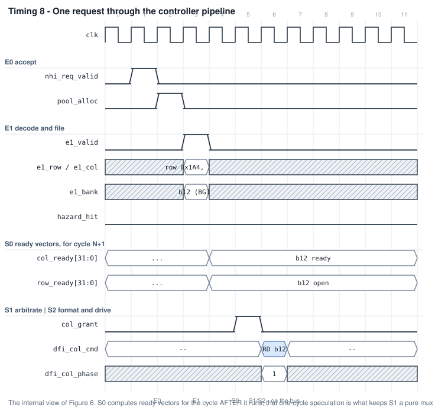

| Stage | Does |
|---|---|
| **E0** | accept from NHI, consume a credit, allocate a transaction-pool entry |
| **E1a/E1b** | `div30` + BG/BA hash → `{bg, ba, row, col}`; write-buffer hazard check; file into the per-bank list. **Two cycles** — see the note below |
| **S0** | evaluate **all** DRAM timing for cycle N+1 → two 32-bit ready masks |
| **S1** | two priority encoders pick one row and one column command — combinational |
| **S2** | encode onto the DFI buses, choose the CK phase |
| **D0+** | write data out at CWL, read data in at CL, ECC, respond |

> **Why is S0 speculative?** If ready evaluation ran in the same cycle as arbitration, the
> critical path would be *counter compare → mask build → priority encode → command mux*.
> That does not close at 1 GHz. Splitting it means S1 sees only a 32-bit mask and a rotating
> pointer. The cost is that S0's answer is one cycle stale, which is handled by having S0
> compute readiness *for* cycle N+1 rather than for cycle N.

**Fast path:** when the pool is empty and the target row is already open, E1b feeds S1
directly and skips the pool write and the speculative window.

> **Changed in Rev 0.4, discovered during implementation.** `div30` is a 20×21 constant
> multiply. That does not close at 1 GHz in a single stage, so `hbm4_divc` is pipelined over
> **two** cycles and E1 became E1a/E1b. End-to-end idle read latency is therefore **33 ns,
> not 32** (§14.2), and the controller-attributable portion is 10 clocks rather than 9.
>
> This is the right place to spend the cycle: address decode is off the arbitration critical
> path, so one extra stage there costs 1 clock on a path already dominated by ~16 clocks of
> DRAM latency, and it removes all timing risk from a block replicated 256 times.

### 8.2 Transaction pool and per-bank lists

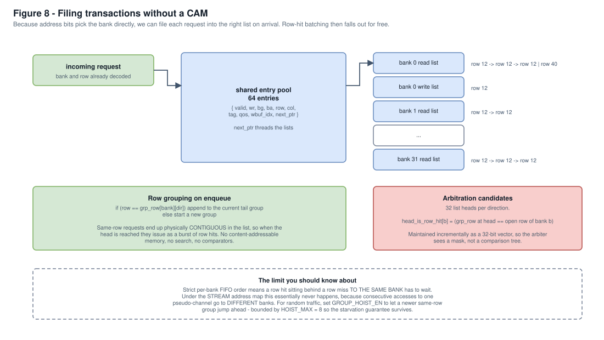

`TQ_DEPTH` = 64 entries, ~72 bits each, in a flop array (it needs three read ports, so SRAM
is not viable).

> **Why 64?** It must cover `tRC` (the full row cycle, 43 core clocks (P)) of continuous
> issue at 1 command/clock. If the pool were shallower, a bank stalling on a row cycle would
> drain the queue and the column bus would go idle — which C1 says you can never afford.

The filing trick: because address bits pick the bank deterministically, a request can be
placed into the correct per-bank list *on arrival*. On enqueue:

```
  if (row == grp_row[bank][dir])  append to the current tail group
  else                            start a new group
```

Same-row requests end up physically contiguous, so when the head is reached they issue as a
burst of row hits. **No content-addressable memory, no search, no comparator tree.** Only
the 32 list heads are ever arbitration candidates.

> ⚠️ **The limit you must know.** Strict per-bank FIFO order means a row hit sitting behind a
> row miss *to the same bank* has to wait. Under `STREAM` this essentially never happens,
> because consecutive accesses to one PC go to *different* banks. For random traffic, set
> `GROUP_HOIST_EN` to let a newer same-row group jump ahead — bounded by `HOIST_MAX` = 8 so
> the starvation guarantee in §8.9 survives.

### 8.3 The timing engine

The DRAM has ~20 timing parameters. The naive implementation is one counter per parameter
per bank: 20 × 32 = 640 counters per PC, 163 840 system-wide. Too much.

Instead, collapse them into "earliest legal cycle" counters, one per bank per *command
class*:

| Counter | Scope | Folds in |
|---|---|---|
| `t_act_ok[32]` | bank | tRP, tRC, tRFC |
| `t_col_ok[32]` | bank | tRCD, tCCD, tWTR, tRTW |
| `t_pre_ok[32]` | bank | tRAS, tRTP, tWR + CWL + BL/2 |
| `t_ccdl[4]`, `t_rrdl[4]` | bank group | tCCD_L, tRRD_L |
| `t_ccds`, `t_rrds` | PC | tCCD_S, tRRD_S |
| `faw_sr[4]` | PC | tFAW (shift register of ACT timestamps) |
| `t_wtr`, `t_rtw` | PC | turnaround |

Saturating down-counters, one decrement per clock. Ready generation is then trivial:

```
  col_ready[b] = (t_col_ok[b]==0) & (t_ccdl[bg(b)]==0) & (t_ccds==0)
                 & dir_ok(head_dir[b]) & !refresh_block[b]
  row_ready[b] = (t_act_ok[b]==0) & (t_rrdl[bg(b)]==0) & (t_rrds==0)
                 & faw_slot_avail & !refresh_block[b]
```

~720 flops per PC, ~184 k system-wide. All values are CSR fields in core clocks, computed by
firmware from your datasheet at the operating frequency.

> This block, together with §8.7 and §8.8, is where **formal verification is mandatory**. A
> timing violation that simulation happens not to hit is a silicon failure with no
> workaround. See [06-verification-plan.md §4.1](06-verification-plan.md).

### 8.4 Direction FSM — read/write turnaround

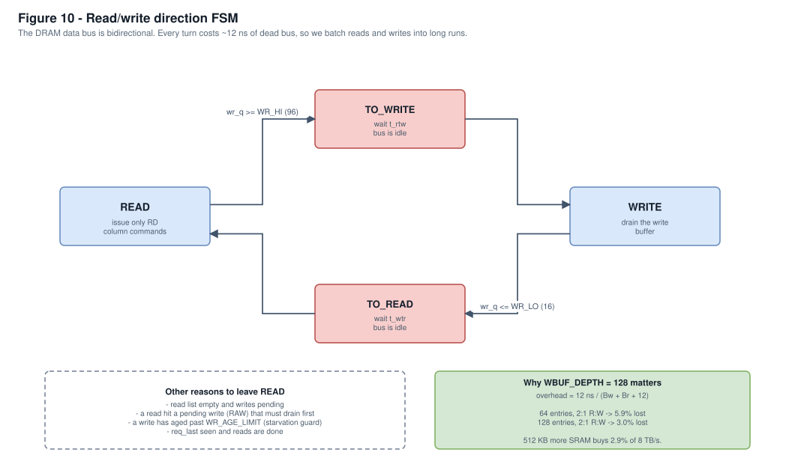

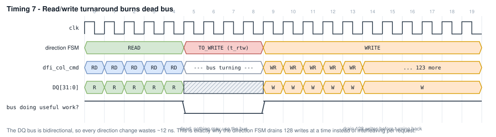

The DQ bus is bidirectional. Turning it around costs `tRTW + tWTR_S` ≈ 12 ns (P) of
completely dead bus. With a write drain of `Bw` accesses and a read run of `Br` (1 access =
1 ns):

```
  turnaround overhead  =  12 / (Bw + Br + 12)
```

| `WBUF_DEPTH` | 2:1 read:write | 1:1 |
|---|---|---|
| 32 (1 KB) | 11.1% | 15.8% |
| 64 (2 KB) | 5.9% | 8.6% |
| **128 (4 KB)** ← baseline | **3.0%** | **4.5%** |
| 256 (8 KB) | 1.5% | 2.3% |

**Baseline `WBUF_DEPTH` = 128 = 4 KB per PC = 1 MB system-wide.** That extra 512 KB over
`WBUF_DEPTH=64` buys 2.9% of 8 TB/s — about 240 GB/s. Good trade.

Leave `READ` when writes hit `WR_HI` (96), or reads are empty, or a read hit a pending write
that must drain, or a write aged past `WR_AGE_LIMIT`. Leave `WRITE` when writes fall to
`WR_LO` (16), or the burst credit (128) is spent, or an urgent read arrives with
`WR_PREEMPT_EN`.

### 8.5 Write buffer and the RAW hazard

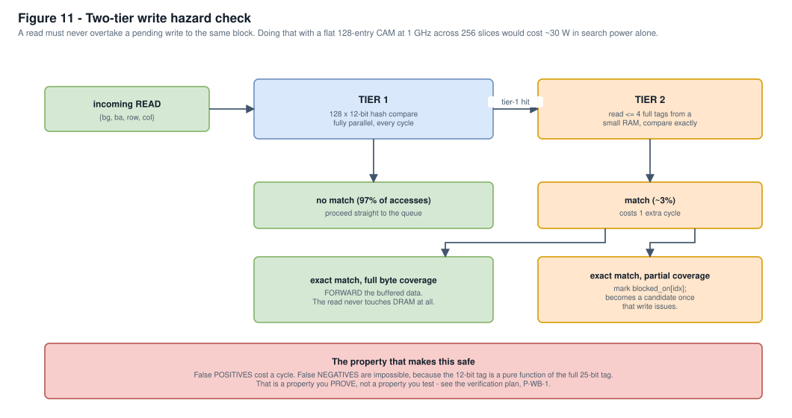

A read must never overtake a pending write to the same block.

> **Why not just a CAM?** A flat 128-entry × 25-bit CAM searched every cycle, at 1 GHz, across
> 256 slices, is roughly 30 W in search power alone. That is the whole power budget of a
> reasonable controller, spent on a check that misses 97% of the time.

So it is tiered: a 128-entry × **12-bit hash** compare runs every cycle (cheap), and only on
a hit do we read ≤4 full tags from a small RAM and compare exactly (1 extra cycle, ~3% of
accesses).

**False positives cost a cycle. False negatives are impossible**, because the 12-bit tag is a
pure function of the full 25-bit tag. That is a property you *prove* (P-WB-1), not one you
test.

The buffer also does two things that pay for the structure:

- **Coalescing** — a write hitting a non-issued entry merges into it, OR-ing byte enables.
  This is what keeps partial writes off the ECC read-modify-write path (§10.4).
- **Forwarding** — an exact hit with full byte coverage returns the buffered data directly.
  The read never touches DRAM at all.

> **Status (Rev 1.4):** `hbm4_wbuf` tracks hazards only and holds no data. Write data lives in
> `hbm4_wdata_ram`, one 32 B entry per transaction-pool entry. Forwarding is not implemented:
> a read that hits a pending write is held back (`raw_block`) until the write drains.
> **Coalescing breaks that protection for a second write to the same block.** The second write
> merges into the first one's entry, and the first write's issue clears it, so a read can then
> overtake the second write and return the first write's data (OPEN-15, confirmed in
> simulation). Both writes still issue to the DRAM.

### 8.6 The two arbiters

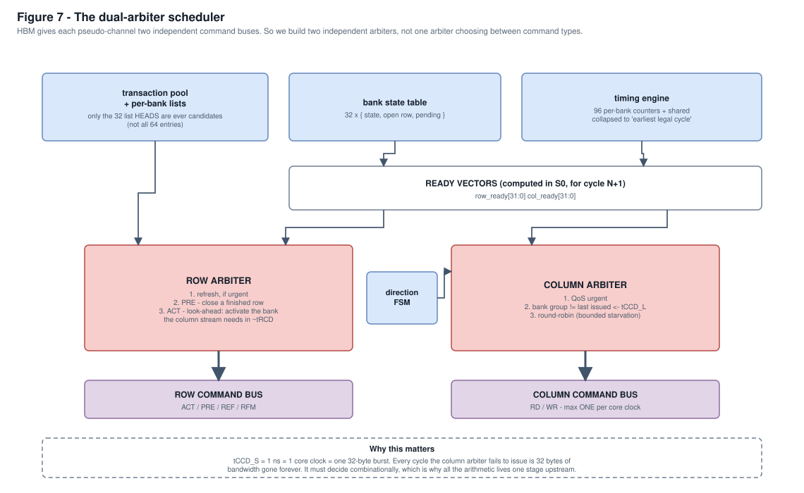

**Column arbiter** (the critical cycle). Input: `col_ready[32] & bank_pending_dir[32]`.
One cycle to select:

1. QoS urgent
2. round-robin on a rotating 32-bit pointer

Two masked priority encoders, ~7 logic levels. Still the tightest path in the design.

> **Rev 0.5 removed a third tier** that preferred a different bank group from the last issue.
> It was redundant — the timing engine does not mark a same-bank-group candidate ready until
> tCCD_L has elapsed, so C2 is enforced upstream and every candidate here is already legal.
> Removing it also restored the starvation bound (§8.7).

**Row arbiter**, same cycle, different bus (C3):

1. refresh, if urgent
2. PRE — bank open on a finished row with different-row requests pending
3. ACT — **look-ahead**: activate the bank the column stream will need in about `tRCD`

> **Why look-ahead and not just "activate whatever is pending"?** Activate too early and you
> burn tRAS/tFAW budget and power on a row you cannot use yet. Activate too late and the
> column bus stalls, which C1 forbids. The scheduler estimates how many clocks until each
> bank's head group is reached and targets `tRCD` ahead. The estimate is deliberately
> approximate — being wrong costs a bubble, never correctness, and no property in the
> verification plan is allowed to depend on it.

### 8.7 Starvation bounds

Livelock in a streaming scheduler is exactly the bug class that survives simulation, so
every arbitration point has a stated, proved bound:

| Mechanism | Bound |
|---|---|
| column round-robin | a ready bank waits ≤ N_BANK−1 issue slots — **proved** (fv_col_arb) |
| `HOIST_MAX` | a group is passed ≤ 8 times |
| `WR_AGE_LIMIT` | a write drains within 4096 clocks |
| QoS aging | effective QoS +1 every `AGE_TICK` (512) clocks, capped at 3 |
| `wr_burst_credit` | reads resume within 128 write accesses |
| `ECC_AGE_LIMIT` | an ECC fill is deferred ≤ 1024 clocks |

QoS urgency sits above round-robin in the column arbiter, so it *could* starve bulk traffic —
except that aging promotes bulk entries to urgent too, at which point they rejoin
round-robin. That interaction is the reason both mechanisms exist.

> **Restored in Rev 0.5, and worth reading.** Rev 0.4 had to withdraw this bound. An earlier
> version of §8.6 had a third arbiter tier that preferred a different bank group from the
> last issue, and it could exclude a ready bank from the selected tier entirely — so the
> rotating pointer swept past without granting, and the bound did not hold.
>
> Attempting to prove the property is what revealed that the tier was **redundant**: the
> timing engine already refuses to mark a same-bank-group candidate ready until tCCD_L has
> elapsed, so every candidate the arbiter can see is already legal. Deleting the tier
> restored the bound (rotational distance strictly decreases on every grant), removed a
> register, and shortened the critical path.
>
> The bound is now proved unbounded by k-induction. **A property you cannot prove is often
> telling you something about the design, not about the property.**

---

## 9. Refresh

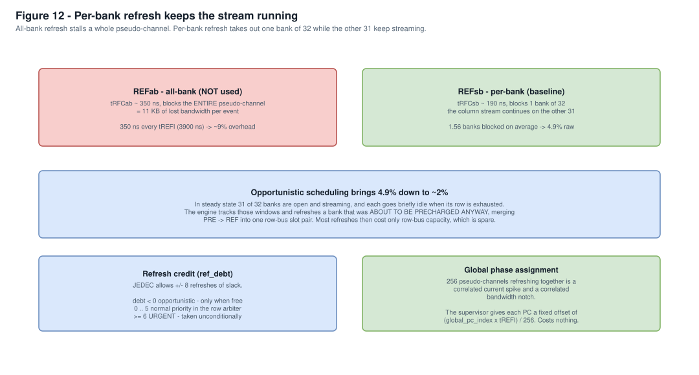

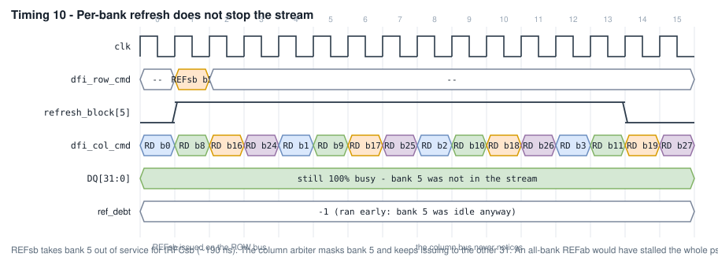

**Per-bank (REFsb), not all-bank (REFab).** REFab stalls an entire pseudo-channel for
`tRFCab` ≈ 350 ns (P) — 11 KB of lost bandwidth per event, about 9% overhead. REFsb costs
`tRFCsb` ≈ 190 ns but blocks only 1 bank of 32 while the other 31 keep streaming.

Raw cost: a REFsb every `tREFI/32` = 122 ns, each blocking a bank for 190 ns, means
`190/122 = 1.56` banks blocked on average = **4.9%** of bank capacity.

**Opportunistic scheduling brings that to ~2%.** In steady state 31 of 32 banks are open and
streaming, and each goes briefly idle when its row is exhausted. The engine tracks those
windows and refreshes a bank that was *about to be precharged anyway*, merging PRE→REF into
one row-bus slot pair. Budgeted at 3.0% for margin.

**Credits.** JEDEC allows ±8 refreshes of slack, tracked as `ref_debt`:

| `ref_debt` | Behaviour |
|---|---|
| < 0 (ahead) | opportunistic — issued only when free |
| 0 … 5 | normal priority in the row arbiter |
| ≥ 6 | **urgent** — taken unconditionally, column arbiter masks the bank |

**Global phase assignment.** 256 pseudo-channels refreshing together is a correlated current
spike *and* a correlated bandwidth notch. The supervisor gives each PC a fixed offset of
`(global_pc_index × tREFI) / 256`. Costs nothing, removes a power-delivery problem.

**Row hammer.** Per-bank RAA (rolling accumulated ACT) counters trigger RFM; where the device
supports Directed RFM, a small per-bank aggressor table makes mitigation far cheaper.
`RFM_MODE` is `OFF`/`RFM`/`DRFM` and is **lockable** — it is a data-integrity setting, not a
performance knob.

---

## 10. RAS and ECC

Three independent layers over three different failure domains. They are not alternatives.

### 10.1 Link ECC — protects the interconnect

Covers micro-bumps, TSVs, and the PHY path, where transient errors at 8 Gb/s actually happen.
Generated per burst on writes, checked per burst on reads.

**Read retry** (default on): a link error is transient by nature, so re-issuing usually
succeeds and the host never sees it. Bounded at 3 attempts, then escalated. Crossing
`LECC_THRESH` raises an interrupt and triggers a link retrain (§14.4).

> **Status (Rev 1.4):** only the read-side check is built (`hbm4_link_ecc` on the return
> path). No link-ECC code is generated for writes, because the DFI has no write-code output.
> Retry is disabled (OPEN-9), so a link uncorrectable returns `rsp_err = 2`. The threshold
> output is not connected above the slice (`hbm4_stack_top` drops it), so no interrupt exists.
> With the threshold tied to `0xFFFF` it asserts once 65 535 corrected beats accumulate. There
> is no retrain path.

### 10.2 On-die ECC — protects the DRAM array

The DRAM corrects single-bit array faults internally and invisibly. You cannot see
corrections directly, but a rising on-die correction rate is the leading indicator of a dying
die — so the sequencer polls the on-die ECC status mode registers every 100 ms and
accumulates per-channel counters. `ALERT_n` is captured and timestamped.

> **Status (Rev 1.4):** not implemented. There is no on-die ECC status polling and no
> `ALERT_n` input.

### 10.3 Inline system ECC — protects end to end (**on by default**)

> **Status (Rev 1.4): not integrated.** `hbm4_ecc_cache` is not instantiated, so nothing
> encodes or checks stored data. The address map still reserves 2 of 32 columns (`div30`),
> which is 6.25% of capacity, and no ECC column accesses are issued. The rest of this section is
> the specification. See [09 Release Notes](09-release-notes.md).

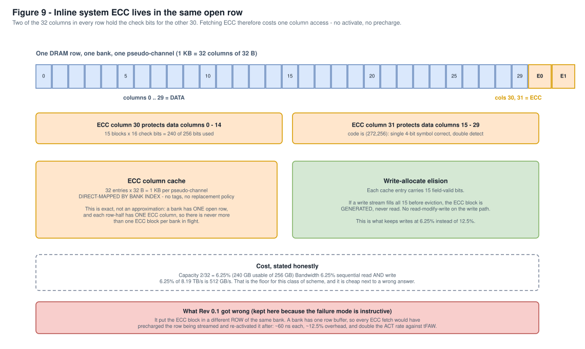

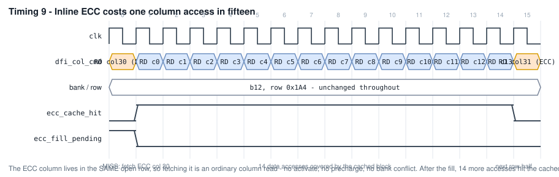

```
  Every row holds 32 columns of 32 B.
    columns  0..29  ->  data
    column   30     ->  ECC for data columns  0..14
    column   31     ->  ECC for data columns 15..29

  One ECC block = 32 B = 256 bits = 15 x 16-bit check fields (16 bits spare).
  Of each 16-bit field: 10 bits are a Hsiao SEC-DED(266,256) code, 1 bit is
  poison, 5 are reserved.  Single-bit correct; double-bit DETECTED and never
  miscorrected.  (Revisions before 0.7 claimed a symbol-correcting code here;
  see docs/08 4.3 -- the claim was corrected downward to match what is built.)
```

**The whole point: the ECC for any block lives in the same bank and the same open row as its
data.** Fetching it is an ordinary column read — no activate, no precharge, no bank conflict.

> **What Rev 0.1 got wrong, and why it is worth knowing.** Rev 0.1 placed the ECC block in a
> reserved *row range* of the same bank. A bank has exactly one row buffer (§1.2), so every
> ECC fetch would have precharged the row being streamed and re-activated it afterwards:
> ~60 ns each, ~12.5% overhead, double the ACT rate against tFAW, and constant bank
> disturbance. With ECC off by default that was a latent flaw in an optional path. Making
> ECC the default turned it into the dominant cost and forced the redesign. **When a default
> changes, re-audit every path that default touches.**

**The ECC column cache** is 32 entries × 32 B per PC (1 KB), **direct-mapped by bank index,
with no tags beyond {row, col-half}, no associativity, and no replacement policy.**

> That is exact, not a simplification. A bank has one open row, and each row-half has one ECC
> column, so there is never more than one ECC block per bank in flight. The structure is
> forced by the DRAM, which is the best kind of design.

**Write-allocate elision:** each entry carries 15 field-valid bits. If a write stream fills
all 15 before eviction — which sequential writes do — the ECC block is *generated*, never
read. That is what keeps writes at 6.25% instead of 12.5%.

| Cost | Value |
|---|---|
| Capacity | 2/32 = **6.25%** (240 GB usable of 256 GB) |
| Bandwidth, sequential read **and** write | **6.25%** |
| Bandwidth, scattered partial writes | up to 12.5% (RMW; see §10.4) |
| Latency, cache hit (~93%) | +1 clock |
| Latency, cache miss | +~2 ns (row hit, same bank, issued in parallel) |
| SRAM | 1 KB per PC = 256 KB system |

6.25% of 8.19 TB/s is 512 GB/s. That is the honest price of end-to-end protection against
silent data corruption, it is the floor for this class of scheme, and it is cheap next to a
wrong answer.

### 10.4 Partial writes

| Case | Behaviour |
|---|---|
| `be` all ones | write data, update the cached ECC field, no read |
| partial `be`, coalesced in the write buffer | usually becomes full before issue |
| partial `be`, not coalesced | **read-modify-write**: read 32 B, merge, recompute, write |

`RMW_COALESCE_WIN` (128 clocks) holds partial writes briefly to let neighbours merge. Deep
write buffers help here too — another reason `WBUF_DEPTH=128` earns its area.

> **Status (Rev 1.4):** not implemented. The NHI as built has no `req_be`, so every write is a
> full 32 B block, and there is no read-modify-write and no `RMW_COALESCE_WIN`.

### 10.5 Poison and scrub

Poison uses a reserved non-codeword in the check field, so it **requires** `SYSECC_EN`
(with ECC off there is nowhere to record it, and `POISON_EN` is forced to 0). A read of a
poisoned block returns `rsp_err = 2` and does **not** raise a new error event — poison is
propagated, not re-reported, so one fault produces one log entry rather than a storm.

Patrol scrub walks the address space at the lowest QoS (never displacing real traffic),
correcting and rewriting correctable errors — a full 960 MB per-PC sweep every ~34 hours.

Error log: 16 entries per stack plus a separate sticky first-error latch, so the first fault
survives a storm. The supervisor merges per-stack logs into one globally timestamped view,
so a correlated multi-stack event (power, thermal) appears as one event, not four.

> **Status (Rev 1.4): not integrated.** Poison needs inline ECC (`hbm4_ecc_cache`), patrol
> scrub is `hbm4_scrub`, and the error log is `hbm4_err_log`. None of them is instantiated. The
> supervisor aggregates per-stack error flags into an interrupt, but nothing is logged.

---

## 11. Multi-stack

| Function | Scope | Why |
|---|---|---|
| PC slices, DFI, PHY | per stack | physically bound to the PHY |
| Init/training sequencer | per stack | training is per-PHY |
| Timing CSRs | per stack | stacks may bin differently |
| Refresh phase | **global** | current spikes correlate across the package |
| Boot orchestration | **global** | one `ctrl_ready`, not four |
| RAS log and IRQ | **global** | correlated events must read as one event |
| DVFS | **global** | under fine interleave, one slow stack throttles everything |
| Perf snapshot | **global** | cross-stack imbalance is otherwise unmeasurable |

### Stack interleave modes

| `STACK_ILV` | Granularity | Property |
|---|---|---|
| `FINE` (default) | 32 B | every stream gets all 8.19 TB/s; needs homogeneous stacks |
| `MEDIUM` | 4 KB | page-granular; some locality for page-aware allocators |
| `NUMA` | contiguous per-stack regions | software placement; survives heterogeneous or degraded stacks |

> ⚠️ **Two consequences of `FINE` you must accept.**
> 1. **Homogeneity is required.** A binning difference makes the map non-uniform and is not
>    expressible in a bit-select slicer. Mixed stacks ⇒ `NUMA` is the only correct mode.
> 2. **No failure containment, no independent idle.** Every 4 KB touches every stack, so one
>    stack's uncorrectable error can surface anywhere, and no stack is ever idle while any
>    traffic runs — per-stack self-refresh never engages. Right for a bandwidth-first
>    accelerator; wrong for a system needing fault isolation or aggressive idle power.

> **Status (Rev 1.4):** one `tcfg` input configures every stack, so stacks cannot be timed
> differently. There is no RAS log (`hbm4_err_log` is not integrated) and no DVFS. `STACK_ILV`
> does not exist: `hbm4_addr_slice` implements the fixed `FINE` order (stack bits directly
> above the 32 B offset), and `MEDIUM` and `NUMA` are not built.

---

## 12. DFI and power

DFI 6.x-style, frequency ratio 1:2, one DFI channel instance per HBM channel (128
system-wide). Two PC slices share one instance. Signal detail: [03-interface-spec.md](03-interface-spec.md).

**Phase selection.** Only one column command may issue per core clock, but it may sit on CK
phase 0 or 1. The adapter tracks the last phase and places the next command on the phase that
exactly satisfies `tCCD_S`, so half-cycle drift never accumulates into a lost slot.

**Read return.** A read-pointer FIFO per PC pushes the pool index at command issue and pops
on `dfi_rddata_valid`. This decouples the controller from the exact PHY latency — only the
FIFO depth must exceed the round trip, and the real value is measured during training.

**Power states:** controller clock gate (4 idle clocks) → DRAM power-down (64) → self-refresh
(8192, per stack, all 64 PCs must vote idle) → DVFS.

DVFS: enter SR → change PHY frequency → retrain → swap the **double-buffered** timing CSR set
→ exit SR. The double buffering exists so the swap is atomic; a torn timing update is
indistinguishable from a scheduler bug and would be near-impossible to debug in silicon.

> **Status (Rev 1.4):** the read-pointer FIFO carries the transaction's tag, not its pool
> index (`col_tag` in `hbm4_dfi_adapter`). `hbm4_pmgr` tracks idle time, but its clock-gate,
> power-down and self-refresh requests drive nothing. There is no DVFS and no double-buffered
> timing set.

---

## 13. Initialization

**The init block is a microcoded sequencer**, not a hardwired FSM: 2 KB script RAM loaded
over APB, ~15 instructions (`WAIT_NS`, `MRS_WRITE`, `PHY_WRITE`, `PATTERN_RD_CMP`, `LOOP`,
`BRANCH_IF`, …), ~2500 gates.

> **Why?** HBM training algorithms differ by vendor, by stack revision, and by bring-up
> iteration. A hardwired FSM *will* be wrong. This buys the ability to fix a training bug
> with a firmware update instead of a metal spin — the highest-leverage 2500 gates in the
> design.

Boot: power ramp → reset → PHY PLL → mode registers → WCK training → write leveling → read DQ
training → write DQ training → latency measurement → lane repair → link ECC on → **ECC region
init** → done. Steps run in parallel across all 32 channels of a stack, and all stacks
concurrently.

> ⚠️ **ECC region init is mandatory and easy to forget.** With `SYSECC_EN` on, every ECC
> column must be written before any data block is read, or the first read of untouched memory
> returns a random check field and reports a spurious uncorrectable error. The hardware fill
> takes `256 GB / 8.19 TB/s ≈ 31 ms`; budget ~50 ms of boot time. `ECCINIT_MODE = LAZY`
> exists for boot-time-sensitive systems but adds a bitmap lookup on the write path and a
> genuinely more complex failure surface. `FULL` is the default and the recommendation.

> **Status (Rev 1.4):** the script is a fixed ROM (`hbm4_seq_rom`), not a RAM loaded over APB,
> and lane repair is not implemented. ECC region init (`hbm4_ecc_init`) is not integrated.
> Inline ECC is absent too, so nothing reads the ECC columns and the spurious-error hazard above
> cannot occur yet. It returns the moment inline ECC is connected without `hbm4_ecc_init`.

---

## 14. Performance

### 14.1 Efficiency budget (2:1 read:write streaming, ECC on)

| Loss | Where it comes from | Cost |
|---|---|---|
| Inline system ECC | 2 ECC columns per 32 (§10.3); elision makes reads and writes cost the same | 6.25% |
| Refresh | 4.9% raw, ~60% absorbed opportunistically → 2.0%; budgeted with margin | 3.0% |
| Turnaround | 12 ns per R→W→R cycle at `Bw`=128, `Br`=256 | 3.0% |
| Row miss | 3.3% miss rate, mostly hidden on the row bus; residual tFAW ramp | 2.0% |
| Scheduling | BG conflicts at stream boundaries, hazard blocks, ECC insertions | 1.5% |
| Periodic | ZQ, retrain, MRS polling | 0.3% |
| **Net** | | **83.9%** |

**= 6.88 TB/s of 8.19 TB/s.** Target set at 83.0% (6.80 TB/s) for margin. With
`SYSECC_EN = 0`: 90.2% = 7.38 TB/s — the ECC decision, made visible.

> **Status (Rev 1.4):** this is an analytic budget for the specified design. Inline ECC is not
> integrated, so the RTL issues no ECC column accesses. The slice simulation measures 98.8%
> column-bus utilisation on streaming reads at production geometry, with no writes and no ECC,
> so that number is not comparable with this 2:1 budget.

### 14.2 Latency budget (idle, read, row hit, ECC cache hit)

| Stage | Clocks |
|---|---|
| NHI accept (synchronous — no CDC) | 1 |
| `div30` + hash + hazard (fast path, 2-stage divider — §8.1) | 3 |
| Arbitration + command format | 2 |
| DFI TX → PHY → DRAM pin | 3 |
| **DRAM: tRCD (0 on a row hit) + CL** | ~16 |
| DRAM pin → PHY → DFI RX | 4 |
| Link ECC + system ECC check | 2 |
| Response assembly + NHI | 2 |
| **Total** | **33 clocks = 33 ns** |

**Only 10 of those 33 clocks belong to the controller.** The rest is DRAM and PHY physics that
no architecture can remove. Row miss adds `tRCD` ≈ 14 clocks → ~47 ns.

### 14.3 Area (system, order-of-magnitude)

| Block | Instances | Estimate |
|---|---|---|
| Write buffer SRAM | 256 × 4 KB | **1 MB** |
| Transaction pool (flops) | 256 × 64 × 72 b | ~1.18 Mb |
| Timing counters + bank state | 256 × ~1.2 kb | ~307 kb |
| Hazard tier-1 + tier-2 tags | 256 | ~490 kb |
| ECC column cache | 256 × 1 KB | **256 KB** |
| ECC codec, `div30` | 256 × 3 | ~8 k gates each PC |

SRAM/flop dominated. The two big knobs are `WBUF_DEPTH` (linear area vs turnaround) and
`SYSECC_EN` (256 KB + 6.25% bandwidth for SDC protection).

**These are analytic numbers.** Before trusting them, cross-check against an independent
model — see [06-verification-plan.md §6.4](06-verification-plan.md).

> **Status (Rev 1.4):** as built, the write buffer holds hazard tags and no data. Write data is
> in `hbm4_wdata_ram` (64 × 32 B = 2 KB of flops per pseudo-channel), and there is no ECC column
> cache. Synthesized numbers are in [syn/README.md](../syn/README.md).

---

## 15. Figure and waveform index

| | |
|---|---|
| [Fig 1](figures/fig-01-system-context.drawio.svg) | System context |
| [Fig 2](figures/fig-02-rtl-hierarchy.drawio.svg) | RTL hierarchy |
| [Fig 3](figures/fig-03-pc-slice.drawio.svg) | Inside a PC slice |
| [Fig 4](figures/fig-04-clock-domains.drawio.svg) | Clock domains |
| [Fig 5](figures/fig-05-address-map.drawio.svg) | Address map |
| [Fig 6](figures/fig-06-pipeline.drawio.svg) | Pipeline |
| [Fig 7](figures/fig-07-scheduler.drawio.svg) | Dual arbiter |
| [Fig 8](figures/fig-08-txn-lists.drawio.svg) | Transaction lists |
| [Fig 9](figures/fig-09-ecc-layout.drawio.svg) | ECC layout |
| [Fig 10](figures/fig-10-direction-fsm.drawio.svg) | Direction FSM |
| [Fig 11](figures/fig-11-write-hazard.drawio.svg) | Write hazard |
| [Fig 12](figures/fig-12-refresh.drawio.svg) | Refresh |
| [Fig 13](figures/fig-13-verification-flow.drawio.svg) | Verification flow |
| [Fig 14](figures/fig-14-deliverables.drawio.svg) | Deliverables |
| [T1](waves/wave-01-nhi-read.svg)–[T11](waves/wave-11-apb-csr.svg) | Timing diagrams — see [03-interface-spec.md](03-interface-spec.md) |

All figures are `.drawio.svg`: they render as images *and* open editable in diagrams.net or
the VS Code draw.io extension. Regenerate with `python3 tools/gen_figures.py`. Timing
diagrams have WaveDrom `.json` sources next to them; regenerate with
`python3 tools/gen_waves.py`.

---

## 16. Open items

### Resolved

Multi-stack (`N_STACK`=4), ECC default on, `WBUF_DEPTH`=128, NHI synchronous, fabric-side
`HBM4_ADDR_SLICE`.

### Must be confirmed from JESD270-4 / vendor datasheet

1. Bank-group / bank counts per PC (assumed 4 × 8).
2. **Burst length and access granularity** — assumed BL8 / 32 B. If HBM4 defines BL16 / 64 B,
   a burst becomes 2 core clocks, the column arbiter gains slack, §8.6's timing pressure
   eases, and the ECC field width per block doubles. **Highest-impact open item.**
3. Full timing table at 8 Gb/s.
4. Row/column command bus widths and encodings.
5. SID addressing for 12-/16-high (the `ROW + SID = 15` split in §5).
6. Link ECC code definition and sideband signalling.
7. DRFM support and its command format.
8. PHY vendor's DFI revision, training algorithm, lane-repair mechanism.

### Decisions still open

9. **`N_STACK`** — set to 4 as a baseline. One parameter. Note that 6 is not expressible
   under `FINE` interleave (non-power-of-two bit-select) and would force `MEDIUM`/`NUMA`.
10. **`STACK_ILV`** — confirm the `FINE` trade in §11 is acceptable.
11. **`ECCINIT_MODE`** — `FULL` (~50 ms boot) or `LAZY`. §13 recommends `FULL`.
12. **NHI at 1 GHz** — confirm the fabric can deliver it.

---

## Appendix A — placeholder timing values

In ns and core clocks at 1 GHz (1 clock = 1 ns). **All (P). Replace from datasheet.**

| Param | ns | clk | Param | ns | clk |
|---|---|---|---|---|---|
| tRCD | 14 | 14 | tCCD_S | 1 | 1 |
| tRP | 14 | 14 | tCCD_L | 2 | 2 |
| tRAS | 29 | 29 | tWTR_S | 5 | 5 |
| tRC | 43 | 43 | tWTR_L | 10 | 10 |
| tRRD_S | 2 | 2 | tRTW | 7 | 7 |
| tRRD_L | 4 | 4 | tRTP | 5 | 5 |
| tFAW | 14 | 14 | tWR | 15 | 15 |
| CL | 16 | 16 | tRFCab | 350 | 350 |
| CWL | 8 | 8 | tRFCsb | 190 | 190 |
| tREFI (≤85 °C) | 3900 | 3900 | tREFI (>85 °C) | 1950 | 1950 |
