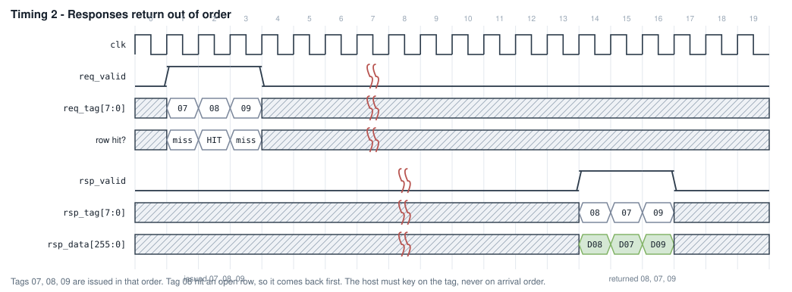
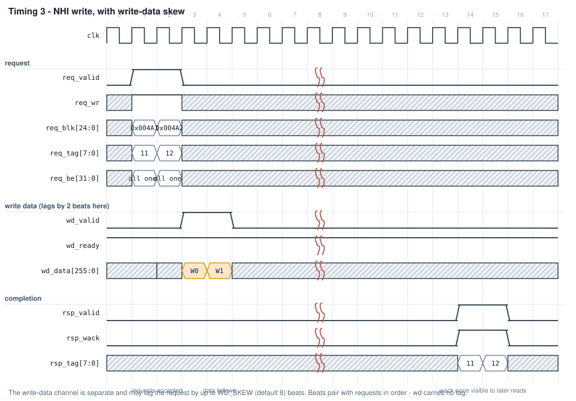
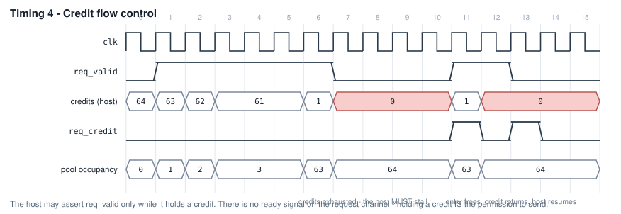
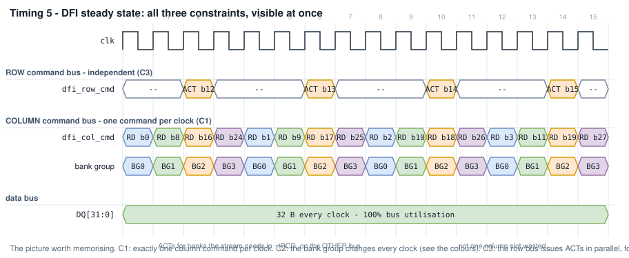
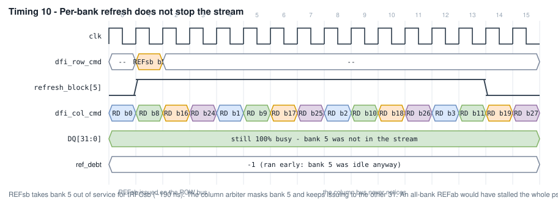
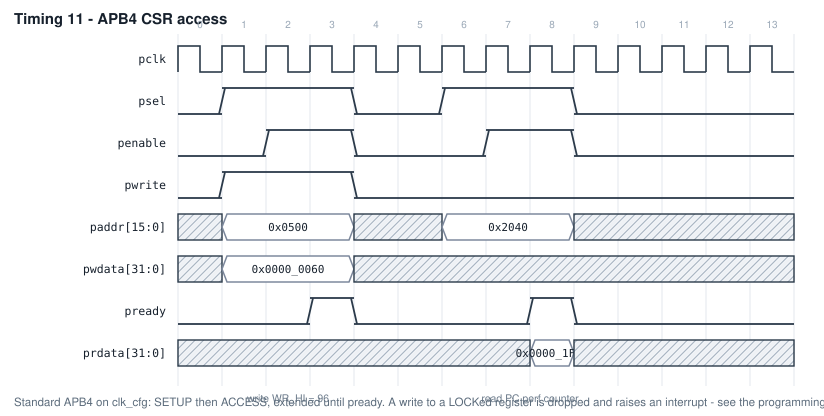

# 03 — Interface Specification

**HBM4 Memory Controller · Rev 1.4**

Signal-level definition of every controller boundary, with timing diagrams. This is the
document to hand to whoever writes the fabric adapter, the PHY glue, or the driver.

Three interfaces:

| Interface | Direction | Clock | Count |
|---|---|---|---|
| **NHI** — Native Host Interface | host ↔ controller | `clk_core` (1 GHz) | 256 (one per pseudo-channel) |
| **DFI** — DDR PHY Interface | controller ↔ PHY | `clk_core` = `dfi_clk` | 128 (one per HBM channel) |
| **APB4** — configuration | host ↔ controller | `clk_cfg` | 1 |

> **Status (Rev 1.4): this is the specification. The RTL differs in places, and each section
> below says how.** In short: `hbm4_sys_top` runs on one clock (`clk`) and has no APB port,
> because `hbm4_csr` is not integrated. Configuration arrives on input ports instead (`tcfg`,
> `lcfg`, `cfg_*`, `irq_mask`), and boot uses `boot_start` / `ctrl_ready` / `boot_failed`. See
> [09 Release Notes](09-release-notes.md).

Every timing diagram below has an editable WaveDrom source in [`waves/`](waves/). Paste the
`.json` into wavedrom.com or open it with the WaveDrom VS Code extension.

---

## 1. NHI — Native Host Interface

### 1.1 Design intent

A tagged, credit-metered, out-of-order request/response interface at exactly the DRAM access
granularity (32 B). Deliberately minimal: no burst descriptors, no ID-ordering matrix, no
exclusive access, no protocol FSM, and **no `ready` on the request channel**.

One port per pseudo-channel. Port *i* is hardwired to pseudo-channel *i*. There is no routing
inside the controller — [`HBM4_ADDR_SLICE`](#4-hbm4_addr_slice) in your fabric decides which
port a request goes to.

> **Status (Rev 1.4): what the RTL implements.** Request: `req_valid`, `req_wr`, `req_blk`,
> `req_tag` (8 b), `req_qos` (2 b), **`req_data` (256 b, valid in the same beat as its
> request)** and `req_credit`. Response: `rsp_valid`, `rsp_ready`, `rsp_tag`, `rsp_data`,
> `rsp_err`, `rsp_wack`. **Not implemented:** the separate write-data channel of §1.3
> (`wd_valid` / `wd_ready` / `wd_data`) and `WD_SKEW`, `req_be` (every write is a full 32 B
> block), `req_poison` and `req_last`. `rsp_err` is 0, 1 (link-ECC corrected) or 2 (link-ECC
> uncorrectable). **`rsp_err = 3` is never generated:** a request whose block address
> decodes beyond capacity is dropped with no response, and its credit never returns. That is an
> open item, see [09 Release Notes](09-release-notes.md).

### 1.2 Request channel — host → controller

| Signal | Dir | Width | Description |
|---|---|---|---|
| `req_valid` | in | 1 | Request present. May be asserted only while the host holds ≥1 credit. |
| `req_wr` | in | 1 | 0 = read, 1 = write |
| `req_blk` | in | 25 | PC-local **block** address, 32 B units. Direct output of `HBM4_ADDR_SLICE`. |
| `req_tag` | in | 8 | Host-chosen. Echoed on the response. Must be unique among the host's outstanding **reads** on this port. |
| `req_be` | in | 32 | Write byte enables, one per byte. All-ones is the fast path. Ignored for reads. |
| `req_qos` | in | 2 | 0 = bulk, 1 = normal, 2 = high, 3 = urgent |
| `req_poison` | in | 1 | Write carries known-bad data; store poison. Requires `SYSECC_EN`. |
| `req_last` | in | 1 | Advisory: end of a contiguous stream. Permits early page close. Never affects correctness. |
| `req_credit` | **out** | 1 | One-cycle pulse. Returns one credit. |

### 1.3 Write-data channel — host → controller

Separate from the request channel so a host can pipeline addresses ahead of data.

| Signal | Dir | Width | Description |
|---|---|---|---|
| `wd_valid` | in | 1 | |
| `wd_ready` | out | 1 | |
| `wd_data` | in | 256 | One 32 B access, one beat |

**Association rule:** write-data beats pair with write **requests in order**. The *n*-th
`wd_valid & wd_ready` beat belongs to the *n*-th `req_valid & req_wr` request. There is no
tag on `wd`. Data may lag or lead its request by up to `WD_SKEW` beats (default 8).

### 1.4 Response channel — controller → host

| Signal | Dir | Width | Description |
|---|---|---|---|
| `rsp_valid` | out | 1 | |
| `rsp_ready` | in | 1 | See the stall rule in §1.6 |
| `rsp_tag` | out | 8 | Echo of `req_tag` |
| `rsp_data` | out | 256 | Read data. Undefined when `rsp_wack` is set. |
| `rsp_err` | out | 2 | 0 = ok, 1 = corrected, 2 = uncorrectable/poison, 3 = access fault |
| `rsp_wack` | out | 1 | This beat is a write completion, not read data |

### 1.5 Timing

**Basic read.** `req_tag` is echoed verbatim, so the host never tracks ordering.


**Out-of-order return.** Tags 07, 08, 09 issue in that order; 08 hit an open row and returns
first. Key on the tag, never on arrival order.



**Write with data skew.** Requests at cycles 1–2, data at cycles 3–4, `wack` later.

> **Status (Rev 1.4):** this shows the specified `wd` channel. In the RTL, write data arrives
> on `req_data` in the request's own beat, with no skew.



**Credit flow control.** A credit *is* the permission to send; there is no request-channel
handshake.



### 1.6 Rules the host must obey

| # | Rule | Consequence of breaking it |
|---|---|---|
| H1 | Assert `req_valid` only while holding ≥1 credit | Transaction pool overflow — dropped request, no error signalled |
| H2 | `req_tag` unique among outstanding **reads** on this port | Two responses collide; data delivered to the wrong consumer |
| H3 | Supply write data within `WD_SKEW` beats of the request | Write-data FIFO underflow, port stalls |
| H4 | Do not hold `rsp_ready` low longer than `RSP_STALL_MAX` | Back-pressure reaches the DRAM bus; IRQ raised |
| H5 | Never re-order write data beats relative to write requests | Data written to the wrong address — **silent corruption** |

H2 and H5 are the dangerous ones: neither is detectable by the controller, and both corrupt
data silently. The verification kit ships NHI protocol assertions
([06-verification-plan.md §4.7](06-verification-plan.md)) — bind them to your fabric adapter
and leave them enabled in simulation.

> **Status (Rev 1.4):** H3 and H5 do not apply to the RTL as built, because write data travels
> with its request. H2 is unchanged, and it is sufficient: write data is stored per transaction
> (by transaction-pool entry), so reusing a tag across outstanding writes is safe. Rev 1.3
> stored it by tag, and a tag reused that way, or two tags 64 apart, corrupted a queued write.
> **H4 is stricter in the RTL than written: do not deassert `rsp_ready` at all.** The slice does
> not honour back-pressure, so any stall that coincides with a completion loses that response
> and its credit (OPEN-16 in [formal/ASSUMPTIONS.md](../formal/ASSUMPTIONS.md)). The stall
> watchdog is fixed at 65 535 cycles (there is no `RSP_STALL_MAX` parameter) and reported on
> `err_stall`, which feeds `irq_status`. **No NHI protocol checker ships:** the assertions named
> above do not exist in the repository, and H1 exists only as an assumption inside
> `fv_nhi_target`.

### 1.7 Ordering contract

**Guaranteed:**

- **G1** A read following a write to the same 32 B block, on the same port, returns the new
  data (enforced by the write-buffer hazard check).
- **G2** Writes to the same block on the same port complete in order.
- **G3** `rsp_wack` is issued only once the write is visible to subsequent reads.

> **Status (Rev 1.4): G1 does not hold when two writes to the same block are queued.** The
> second write merges into the first one's hazard entry, and the first write's issue clears it,
> so a following read can overtake the second write and return the first write's data
> (OPEN-15, confirmed in simulation). G1 holds when only one write to the block is queued. Under
> mixed traffic some `rsp_wack` responses are lost altogether (OPEN-17). See
> [formal/ASSUMPTIONS.md](../formal/ASSUMPTIONS.md).

**Not guaranteed:**

- Response ordering, in general.
- **Any ordering between different ports.** Different pseudo-channels are entirely
  independent memories. If your consistency model needs cross-port ordering, the fabric must
  fence: wait for all outstanding `wack`s before issuing the dependent read.

> ⚠️ This bites people. Two accesses that look adjacent in system address usually land on
> *different* pseudo-channels (§7.2 of [02-architecture.md](02-architecture.md) — a +32 B
> stride changes the stack). There is no ordering between them.

---

## 2. DFI — PHY interface

DFI 6.x-style, frequency ratio **1:2** (`dfi_clk` = `clk_core` = CK/2). One instance per HBM
channel; two pseudo-channel slices share one instance and use the per-pseudo-channel command
and data sub-buses.

### 2.1 Per pseudo-channel, per core clock

| Group | Width | Notes |
|---|---|---|
| `dfi_row_cmd` | 2 × `ROW_CMD_W` | 2 CK phases. ACT / PRE / REF / RFM. |
| `dfi_col_cmd` | 2 × `COL_CMD_W` | 2 CK phases, but **≤1 valid per core clock** (C1) |
| `dfi_wrdata` | 256 | One BL8 burst = one core clock |
| `dfi_wrdata_mask` | 32 | DM / byte enables |
| `dfi_rddata` | 256 | |
| `dfi_rddata_valid` | 1 | |
| `dfi_lecc_*` | per-direction sideband | Link ECC (§10.1 of the architecture doc) |

> **Status (Rev 1.4):** as built, each pseudo-channel has `dfi_row_valid` / `_cmd` / `_bank` /
> `_addr`, `dfi_col_valid` / `_cmd` / `_bank` / `_addr`, `dfi_wrdata_valid`, `dfi_wrdata`,
> `dfi_rddata_valid`, `dfi_rddata` and `dfi_rdcode` (the read-side link-ECC code). There is no
> `dfi_wrdata_mask` and no write-side link-ECC sideband. During boot (until the stack's
> sequencer finishes), every pseudo-channel's **row** bus carries the boot commands, `ROW_PREA` or
> `ROW_MRS`, broadcast on phase 0. The MRS index and opcode travel on the per-stack
> `dfi_mrs_index` / `dfi_mrs_opcode` buses, and PHY training steps use `phy_req`, `phy_op`,
> `phy_arg` and `phy_ack`.

### 2.2 Steady state — the three constraints on one screen



- **C1** exactly one column command per clock — the column port is one wide and saturated.
- **C2** the bank group changes every clock (colours) — `tCCD_S`, not `tCCD_L`.
- **C3** the row bus issues ACTs in parallel, for free.

### 2.3 The bank-group penalty

What C2 costs when you get the address map wrong:


### 2.4 Read/write turnaround


### 2.5 Per-bank refresh

REFsb on the row bus; the column bus never notices.



### 2.6 Phase selection

Only one column command may issue per core clock, but it may sit on CK phase 0 or 1. The
adapter tracks the last issued phase and places the next command on whichever phase exactly
satisfies `tCCD_S`. Without this, a half-cycle of drift accumulates and eventually costs a
whole issue slot.

### 2.7 Read-data return

The adapter keeps a **read-pointer FIFO** per pseudo-channel: push the transaction-pool index
at column-command issue, pop on `dfi_rddata_valid`. This decouples the controller from the
exact PHY latency — only `RD_FIFO_DEPTH` (default 32) must exceed the maximum round trip. The
real value is measured during training (boot step 10) and written to a CSR.

> **Integration note.** If your PHY's `dfi_rddata_valid` latency is not deterministic within a
> known bound, tell us. The FIFO handles jitter; it does not handle unbounded latency.

> **Status (Rev 1.4):** the FIFO carries the transaction's tag, not its pool index, and the
> measured latency has no CSR to go to.

### 2.8 Mode-register access

MRS travels on the column bus. The stack sequencer serialises it against traffic with a
per-PC `mrs_request` handshake: quiesce the PC, issue, resume. Used for init programming,
temperature polling, on-die ECC status, PPR, and lane repair.

> **Status (Rev 1.4):** MRS does not use the column bus. During boot, while the stack's slices
> are gated off, `ROW_MRS` is broadcast on every pseudo-channel's row bus (phase 0), with its
> index and opcode on the per-stack `dfi_mrs_index` / `dfi_mrs_opcode` outputs. There is no
> `mrs_request` handshake, and only init programming is implemented. There is no runtime MRS, temperature or on-die ECC polling, PPR
> or lane repair.

---

## 3. APB4 — configuration

> **Status (Rev 1.4): not integrated.** `hbm4_csr` exists but is not instantiated, so
> `hbm4_sys_top` has no APB port and no register map. It is configured through input ports
> (see `rtl/slice/hbm4_sys_top.sv`). This section is the specification for when the block is
> connected. See [09 Release Notes](09-release-notes.md).

Standard APB4 on `clk_cfg`, 32-bit data, 16-bit address within each window.



| Signal | Dir | Width |
|---|---|---|
| `pclk`, `presetn` | in | 1, 1 |
| `psel`, `penable`, `pwrite` | in | 1 each |
| `paddr` | in | 32 |
| `pwdata`, `prdata` | in / out | 32 / 32 |
| `pready`, `pslverr` | out | 1, 1 |

`pslverr` is asserted for: an unmapped address, a write to a `LOCK`ed register, or a CSR
access to a stack that is not out of reset. See
[04-programming-guide.md](04-programming-guide.md) for the register map.

---

## 4. `HBM4_ADDR_SLICE`

Shipped as `rtl/fabric/hbm4_addr_slice.sv`. **You instantiate this in your fabric**, once per
requester port.

```systemverilog
module hbm4_addr_slice #(
  parameter int N_STACK = 4
) (
  input  logic [37:0] sys_addr,     // byte address, 0 .. 240 GB usable
  input  hbm4_slice_cfg_t cfg,      // mirror of the CSR hash image
  output logic [ 1:0] stack_id,
  output logic [ 5:0] pc_id,
  output logic [24:0] pc_blk        // -> req_blk on NHI port {stack_id, pc_id}
);
```

Purely combinational: bit-select plus XOR reduction, ~200 gates, zero latency. No arithmetic
and no divide — the divide-by-30 that inline ECC needs lives inside the controller.

**The contract.** `cfg` must be the same hash image programmed into the controller's CSRs. If
the two disagree, requests are decoded to different DRAM locations by the fabric and by the
controller, and **memory is corrupted with no error indication anywhere**. This is the
highest-consequence, lowest-visibility failure mode in the system, which is why:

- the hash is one shared RTL source (`rtl/fabric/hbm4_hash.sv`), instantiated by both paths;
- a formal miter proves the two decode paths agree for every input under every legal `cfg`
  ([06-verification-plan.md](06-verification-plan.md), P-MAP-3);
- the hash CSRs are **lockable**, and the driver locks them before enabling traffic.

> **Status (Rev 1.4):** the module as shipped takes no parameters (widths come from
> `hbm4_pkg`), and `cfg` is a `slice_cfg_t` holding the stack and pseudo-channel hash masks,
> driven by you. The controller's own bank hash arrives on `hbm4_sys_top.lcfg`. There are no
> CSRs, so nothing is lockable, and keeping the two in agreement is the integrator's job.

---

## 5. Parameter summary

Parameters that change the interfaces:

| Parameter | Default | Effect on interfaces |
|---|---|---|
| `N_STACK` | 4 | `stack_id` width; number of NHI ports = `N_STACK × 64` |
| `TQ_DEPTH` | 64 | initial credit count on every NHI port |
| `WD_SKEW` | 8 | how far write data may lag its request |
| `SYSECC_EN` | 1 | usable capacity 15/16; enables `req_poison` |
| `RSP_STALL_MAX` | 256 | when a stalled `rsp_ready` raises an IRQ |
| `RD_FIFO_DEPTH` | 32 | maximum tolerable PHY read round trip |

> **Status (Rev 1.4):** `N_STACK`, `TQ_DEPTH` and `SYSECC_EN` are `hbm4_pkg` parameters, and
> `RD_FIFO_DEPTH` is a `hbm4_pc_slice` parameter. `WD_SKEW` and `RSP_STALL_MAX` do not exist.
> `SYSECC_EN` reserves the ECC columns (capacity 15/16), but enables no `req_poison`, because
> neither poison nor inline ECC is integrated.

Full parameter list: [05-integration-guide.md](05-integration-guide.md).
