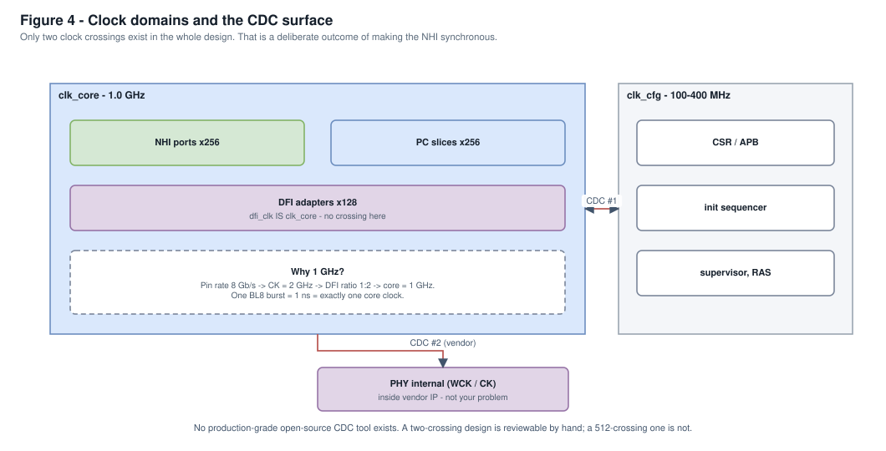

# 05 — Integration Guide

**HBM4 Memory Controller · Rev 1.3**

For the SoC integrator. What to instantiate, what to connect, what to constrain, and the
things that will bite you if you skip them.

---

## 1. What you instantiate

Exactly two modules:

```systemverilog
hbm4_sys_top #(
  .N_STACK       (4),
  .SYSECC_EN     (1),
  .WBUF_DEPTH    (128),
  .TQ_DEPTH      (64)
) u_hbm4 (
  .clk_core      (clk_1ghz),
  .clk_cfg       (clk_apb),
  .rst_n         (cold_rst_n),
  .warm_rst_n    (warm_rst_n),
  .nhi           (nhi_bus),        // 256 ports
  .apb           (apb_bus),
  .dfi           (dfi_bus),        // 128 channels -> your PHY
  .irq           (hbm4_irq)
);
```

and, **in your fabric, once per requester port**:

```systemverilog
hbm4_addr_slice #(.N_STACK(4)) u_slice (
  .sys_addr (req_addr),
  .cfg      (slicer_cfg),          // must match the controller CSRs
  .stack_id (stack_id),
  .pc_id    (pc_id),
  .pc_blk   (pc_blk)
);
```

---

## 2. Parameters

### 2.1 Structural — fixed at elaboration

| Parameter | Default | Notes |
|---|---|---|
| `N_STACK` | 4 | 1/2/4/8. Non-power-of-two requires `STACK_ILV != FINE`. |
| `N_PC_PER_STACK` | 64 | do not change unless the device differs |
| `N_BG`, `N_BA` | 4, 8 | **confirm against JESD270-4** |
| `TQ_DEPTH` | 64 | must cover `tRC` of issue; also the NHI initial credit |
| `WBUF_DEPTH` | 128 | 64 / 128 / 256 |
| `ECC_CACHE_ENTRIES` | 32 | = number of banks; do not change |
| `RD_FIFO_DEPTH` | 32 | must exceed max PHY read round trip |
| `WD_SKEW` | 8 | write-data lag tolerance |
| `PG_GROUP` | 8 | power-gating granularity |
| `ROW_BITS`, `SID_BITS` | 15, 0 | must sum to 15 |
| `SYSECC_EN` | 1 | affects capacity, column count, and the `div30` path |

### 2.2 Runtime — CSR, see [04-programming-guide.md](04-programming-guide.md)

Address map mode, hash masks, all DRAM timing, refresh policy, scheduler policy, RAS
enables, power thresholds.

> **Design rule:** anything that could plausibly need to change after tape-out is a CSR, not
> a parameter. If you find yourself wanting a new parameter, check whether it should be a
> register instead.

---

## 3. Clocking



| Clock | Frequency | Requirement |
|---|---|---|
| `clk_core` | 1.0 GHz (P) | Same clock as DFI `dfi_clk`. Drives all 256 slices **and all 256 NHI ports**. |
| `clk_cfg` | 100–400 MHz | Asynchronous to `clk_core`; the only controller-internal CDC |

### 3.1 The NHI clock constraint — read this before committing to a floorplan

The NHI is **synchronous to `clk_core`**. Your fabric must present traffic at 1 GHz.

> **Why we did this, and what it costs you.** It saves ~5 ns of round-trip latency and
> deletes 512 dual-clock FIFOs. More importantly, it reduces the design's clock-domain
> crossings from 514 to **two** — and there is no production-grade open-source CDC tool
> ([06-verification-plan.md §7](06-verification-plan.md)). Two crossings can be reviewed by
> hand and proved formally. Five hundred cannot.
>
> The cost lands on you: **if your fabric runs slower than 1 GHz, you insert the rate
> adapter.** Widen the fabric and run a 2:1 or 4:1 gearbox at each port group. We
> deliberately did not put it inside the controller, because then the controller would own a
> clock crossing per port and the argument above collapses.

### 3.2 Clock distribution

256 ports on one 1 GHz clock across a large die is a physical-design problem. Budget it
early:

- Place PC slices in groups next to their PHY slices; the NHI port travels with the slice.
- Expect a multi-source clock mesh or a balanced H-tree per stack quadrant.
- Useful skew between the fabric and the slice is fine; **skew within a slice is not** — the
  column arbiter path (~9 logic levels) has no margin to give.

---

## 4. Reset

| Reset | Assert | Deassert | Retains |
|---|---|---|---|
| `rst_n` | async, any time | **synchronised per domain** | nothing |
| `warm_rst_n` | async | synchronised | CSR contents, trained PHY state |

`warm_rst_n` is used for DVFS and error recovery. It must **not** clear the timing registers,
the address map, or the `AMAP_LOCK` bit — otherwise a warm reset silently changes the address
map and corrupts memory.

Deassert order: `clk_cfg` domain first, then `clk_core`. The supervisor holds slices in
reset until boot completes regardless, so the ordering requirement is a belt-and-braces one.

---

## 5. PHY integration

You provide the PHY and its training script.

| Item | Requirement |
|---|---|
| DFI revision | 6.x-style, frequency ratio 1:2 |
| Channels | 32 per stack; two PC slices share one DFI channel instance |
| `dfi_rddata_valid` latency | **must be bounded and reported.** Jitter is fine; unbounded latency is not (`RD_FIFO_DEPTH`). |
| Training | Script loaded into the sequencer's 2 KB script RAM at boot |
| Lane repair | Spare-lane remap via mode registers; scripted |
| Frequency change | PHY call plus a retrain script; controller handles SR entry/exit |

If your PHY's DFI revision or signal set differs, `hbm4_dfi_adapter.sv` is the single file to
modify. It is deliberately thin for this reason.

---

## 6. Address slicing — the one thing that must not go wrong

`HBM4_ADDR_SLICE` is combinational, ~200 gates, and you replicate it per requester port.

**The contract:** the `cfg` bundle driven into every slicer instance must be *identical* to
the hash image programmed into the controller's CSRs.

If they differ, the fabric routes a request to pseudo-channel A while the controller decodes
it as belonging at address B. Data is written to the wrong place and read from the wrong
place, with **no ECC error, no interrupt, and no indication anywhere in the system.** It is
the highest-consequence, lowest-visibility failure mode in the design.

Three defences, all of which you should keep:

1. The hash is **one shared RTL source** (`rtl/fabric/hbm4_hash.sv`), instantiated by both
   the slicer and the controller decode.
2. A **formal miter** proves the two decode paths agree for every input under every legal
   `cfg` ([06-verification-plan.md](06-verification-plan.md), P-MAP-3). Re-run it for your
   configuration.
3. The driver programs CSRs and fabric from **one source struct**, then sets `AMAP_LOCK`
   before enabling traffic.

---

## 7. DFT

Not provided; insert per your methodology. Points to plan for:

| Structure | Notes |
|---|---|
| Write buffer SRAM | 256 × 4 KB — needs MBIST and repair |
| ECC column cache | 256 × 1 KB — MBIST |
| Transaction pool | flop-based, scan-covered |
| Script RAM | 4 × 2 KB — MBIST; also loadable via APB, so functionally testable |
| Timing counters | scan; consider a lightweight observation mux for silicon debug |
| Clock gating | scan-enable must override every gate in the slice |

The 256-way replication is a DFT opportunity: one slice's test patterns broadcast across all
256, with compression on the response. Plan for it rather than treating each slice
independently.

---

## 8. Physical

| Concern | Guidance |
|---|---|
| Floorplan | Slices in groups of 8–16 abutting their PHY. The NHI port travels with the slice; do **not** centralise ports. |
| Critical path | Column arbiter, ~9 logic levels ([02-architecture.md §8.6](02-architecture.md)). Give it priority and do not let synthesis flatten it into something worse. |
| SRAM | 1 MB write buffer + 256 KB ECC cache, distributed per slice. Do not aggregate — locality is why the wires are short. |
| Power | Refresh phase assignment (globally staggered) already smooths the largest correlated current event. ZQ is also staggered. |
| Congestion | The DFI bundle is ~600 wires per PC. Route it as a hard bundle from slice to PHY. |

---

## 9. Integration checklist

**Elaboration**
- [ ] `N_STACK`, `N_BG`, `N_BA` match the device
- [ ] `ROW_BITS + SID_BITS = 15` for your stack height
- [ ] `RD_FIFO_DEPTH` exceeds your PHY's worst-case read round trip
- [ ] `SYSECC_EN` decided (affects usable capacity: 240 GB vs 256 GB)

**Connectivity**
- [ ] All 256 NHI ports connected; port *i* fed by fabric slice *i*
- [ ] `HBM4_ADDR_SLICE` instantiated at every requester port
- [ ] Slicer `cfg` and controller CSRs driven from one driver struct
- [ ] APB reachable before `clk_core` is stable (it is on `clk_cfg`)
- [ ] IRQ connected and unmasked

**Clock and reset**
- [ ] `clk_core` == `dfi_clk`, verified at the PHY boundary
- [ ] Fabric delivers NHI at 1 GHz, or a rate adapter is in place **outside** the controller
- [ ] `warm_rst_n` does **not** clear timing, address map, or `AMAP_LOCK`
- [ ] Reset synchronisers reviewed (this is one of the two CDC boundaries)

**Verification**
- [ ] `make -C formal` re-run with your parameters and timing
- [ ] P-MAP-3 (slicer ≡ controller decode) passes for your `cfg`
- [ ] NHI protocol assertions bound into your fabric adapter and left enabled
- [ ] DFI timing checker enabled in every simulation
- [ ] Every **(P)** value replaced ([08-compliance-matrix.md](08-compliance-matrix.md))

**Software**
- [ ] Boot flow implemented per [04-programming-guide.md §2](04-programming-guide.md)
- [ ] `AMAP_LOCK` set before traffic
- [ ] ECC region initialisation completed
- [ ] Performance floors recorded as regression gates

---

## 10. Common integration mistakes

| Mistake | Symptom | Fix |
|---|---|---|
| Fabric and controller hash images differ | Silent corruption, no errors anywhere | §6; run P-MAP-3 |
| `AMAP_LOCK` never set | Works until something writes a hash register | Lock in the boot path |
| ECC region not initialised | Spurious uncorrectable errors on first read | §2 of the programming guide |
| Cross-port ordering assumed | Rare, data-dependent corruption | Different PCs are independent memories — fence in the fabric |
| `rsp_ready` gated on a slow consumer | Bandwidth collapses; IRQ bit 7 sets | Buffer in the fabric, not by back-pressuring |
| Placeholder timing left in place | Passes simulation, fails in silicon | S12 in the verification plan |
| NHI ports centralised into a crossbar | Timing closure fails, area explodes | Distribute; the architecture assumes it ([02 §2](02-architecture.md)) |
| `req_tag` reused while outstanding | Data delivered to the wrong consumer | H2 in [03 §1.6](03-interface-spec.md); keep the assertions on |

---

## Mandatory integration requirements (Rev 1.0)

These are not recommendations. Each was found by simulation, and each has a failure mode that
is silent — the system comes up and returns wrong data rather than reporting a fault.

### 1. Re-run the full boot sequence after every reset

A reset clears the controller's bank state and timing counters. **It does not close the
device's rows, and it does not stop the device counting out `tRFCsb`.** Resuming traffic
without a full boot means the controller issues commands against a device state it does not
share — refresh to an open bank, or an ACT inside `tRP`.

The design enforces this structurally: `cmd_en` follows `boot_done`, and `boot_done` resets to
zero, so no slice can touch the DRAM until the sequence — which opens with `tINIT` waits and a
`PRECHARGE ALL` — has completed. **Do not bypass `cmd_en`.**

### 2. Drive `phy_ack` honestly

The sequencer waits for `phy_ack` before advancing past a training step. Acking immediately —
or tying it high — marches the script through training while the PHY is still working, and at
the interface that is indistinguishable from training that succeeded. Assert `phy_ack` only
when the step has actually completed.

### 3. Leave `cfg_retry_en` at zero

Link-ECC retry has no usable re-issue path (OPEN-9). Enabling it suppresses responses that
nothing will ever re-drive, turning a correctable link event into a host hang. Link
uncorrectables are reported to the host as errors, which is the supported behaviour.

### 4. Set `AMAP_LOCK` before enabling traffic

Changing the address map, hash masks, `ECC_EN` or the timing set while traffic runs silently
relocates where addresses map. There is no error for it — writes land in one place and later
reads look in another. Set the lock once at boot; post-lock writes are refused with `pslverr`
and an interrupt.

### 5. Do not aggregate the NHI ports back into a crossbar

256 pseudo-channels at 32 B/clk is ~16 000 wires per direction. The design has no central
switch by intent, and each port is meant to be placed next to its PHY slice. Address slicing
belongs in your fabric, using the supplied `hbm4_addr_slice` — which is formally proved
equivalent to the controller's own decode. Re-aggregating undoes the property that makes the
design physically closeable.

### 6. Budget for boot time

The init sequence includes ~200 µs of settling waits plus ECC-region initialisation
(~31 ms at full rate for 256 GB). `BOOT_DELAY_SHIFT` scales the waits **for simulation only**
and must be zero in silicon.
