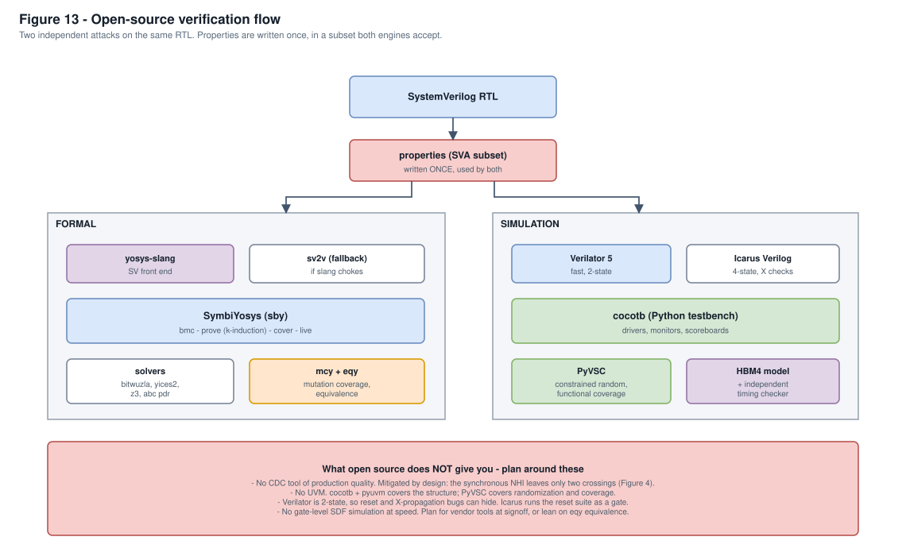

# 06 — Verification Plan

**HBM4 Memory Controller · Rev 1.3 · fully open-source toolchain**

---

## 1. Strategy

Two independent attacks on the same RTL, with the properties written **once** in a subset
both engines accept.



| | Formal (SymbiYosys) | Simulation (Verilator + cocotb) |
|---|---|---|
| Answers | "is this *ever* possible?" | "does the whole thing work?" |
| Scope | small blocks, scaled-down parameters | full system, real traffic |
| Best at | DRAM timing, arbiter liveness, ECC codecs, address bijectivity | integration, boot, performance, error recovery |
| Blind to | anything above ~10⁴ state bits | orderings the stimulus never generates |

**Why formal is not optional here.** A DRAM timing violation is not a functional bug you
find in the lab — it is data corruption that depends on temperature, voltage, and traffic
phase. Random simulation explores maybe 10⁻¹⁰ of the command orderings a real workload
produces. The timing engine and the two arbiters
([02-architecture.md §8.3, §8.6](02-architecture.md)) must be *proved*, not sampled.

**Why simulation is not optional either.** Formal cannot hold the transaction pool, 32 banks,
the write buffer, the ECC cache, and a DRAM model at once. Everything about how the parts
compose — boot, refresh interacting with streams, error recovery, achieved bandwidth — is a
simulation question.

---

## 2. Toolchain

Everything below is open source and installable from source or a package manager. No licence
server, no seat limits — which matters when you ship this IP to multiple customers who each
need to re-run signoff on their own configuration.

| Role | Tool | Notes |
|---|---|---|
| SV front end (formal) | **yosys-slang** | Yosys plugin over the `slang` SystemVerilog front end. Best open-source SV coverage. |
| SV front end (fallback) | **sv2v** → Yosys | If a construct defeats slang. Lossy for interfaces; keep RTL slang-clean. |
| Formal driver | **SymbiYosys (`sby`)** | modes `bmc`, `prove`, `cover`, `live` |
| Solvers | **Bitwuzla** (default), **Yices 2**, **Z3**, **cvc5** | Bitwuzla is fastest on these bit-vector problems; Yices 2 is a good second opinion |
| Unbounded proof | **ABC `pdr`** (IC3/PDR), **avy**, **suprove** | for properties k-induction cannot close |
| Mutation coverage | **mcy** | measures whether the properties actually catch bugs |
| Equivalence | **eqy** | reference-model vs optimised-implementation miters |
| Simulator (primary) | **Verilator 5** | `--timing --assert --coverage --trace-fst` |
| Simulator (4-state) | **Icarus Verilog** | reset and X-propagation gate |
| Testbench framework | **cocotb** | Python coroutines; drivers, monitors, scoreboards |
| UVM structure (optional) | **pyuvm** | UVM 1.2 semantics in Python |
| Constrained random + coverage | **PyVSC** | covergroups, cross coverage, constraint solving |
| Lint | **Verilator `--lint-only`**, **svlint** | pre-commit gate |
| Waves | **GTKWave** or **Surfer** | FST format |
| Performance cross-check | **Ramulator 2**, **DRAMsim3** | independent model of §14 numbers |
| DRAM energy | **DRAMPower** | driven from the DFI command trace |

---

## 3. Properties written once

Yosys and Verilator accept overlapping but **not identical** SVA subsets. Rather than
maintain two property sets, we restrict to what both accept and encode everything else as
auxiliary state.

### 3.1 The portable subset

**Allowed:** `assert` / `assume` / `cover` / `restrict` property blocks; `|->`, `|=>` with
boolean antecedent and consequent; fixed `##n` delays; `$past`, `$rose`, `$fell`, `$stable`,
`$changed`; immediate assertions inside procedural blocks.

**Not allowed:** unbounded `##[1:$]`, `throughout`, `within`, `first_match`, local variables
in sequences, `s_eventually`.

### 3.2 The technique for everything else

Complex temporal properties become **shadow state machines in synthesizable RTL**, then
simple invariants over that state. This is not a workaround — it is more portable, more
debuggable, and it runs in simulation as well as formal.

```systemverilog
// formal/fv_timing_engine.sv  (excerpt)
// P-TIM-1: no column command to a bank sooner than tRCD after that bank's ACT.

logic [7:0] since_act [NB];

always_ff @(posedge clk) begin
  for (int b = 0; b < NB; b++) begin
    if (!rst_n)                                since_act[b] <= '1;   // saturated
    else if (act_issued && act_bank == b)      since_act[b] <= '0;
    else if (since_act[b] != '1)               since_act[b] <= since_act[b] + 1'b1;
  end
end

p_trcd: assert property (@(posedge clk) disable iff (!rst_n)
          col_issued |-> (since_act[col_bank] >= cfg_trcd));
```

The shadow counter is *independent of the DUT's own timing counters*. If the DUT and the
checker shared logic, a bug in that logic would be invisible — the same reason the DRAM model
carries an independently written timing checker (§5.3).

---

## 4. Formal plan

### 4.1 Timing engine and arbiters — the crown jewels

`hbm4_timing_engine.sv`, `hbm4_col_arb.sv`, `hbm4_row_arb.sv`, `hbm4_bank_state.sv`.

| ID | Property | Mode |
|---|---|---|
| P-TIM-1..12 | One per JEDEC parameter (tRCD, tRP, tRAS, tRC, tRRD_S/L, tFAW, tCCD_S/L, tWTR_S/L, tRTP, tWR), each via an independent shadow timer | prove |
| P-TIM-13 | tFAW: never more than 4 ACTs in any tFAW window (4-deep timestamp shift register) | prove |
| P-ST-1 | Never RD/WR to a bank that is not ACTIVE | prove |
| P-ST-2 | Never ACT a bank that is already ACTIVE | prove |
| P-ST-3 | The row read or written always equals the bank's open row | prove |
| P-ST-4 | Bank FSM never reaches an illegal encoding | prove |
| P-BUS-1 | **At most one column command per core clock** (C1) | prove |
| P-BUS-2 | Row and column commands never collide on a bus or phase | prove |
| P-LIVE-1 | A ready bank with a pending head issues within 31 slots (§8.7 bound) | prove |
| P-LIVE-2 | A write drains within `WR_AGE_LIMIT` | prove |
| P-LIVE-3 | No transaction-pool entry stays allocated longer than `BOUND` | bmc + prove |
| P-REF-1 | No bank exceeds `9 × tREFI` without a refresh (the ±8 postpone bound) | prove |
| P-RFM-1 | `RAA_CTR` never exceeds `RAAMMT` | prove |

> Liveness here is deliberately expressed as **bounded** liveness — a counter plus a safety
> assertion — not `s_eventually`. Unbounded liveness rarely closes, and a bound is what the
> architecture actually promises ([02-architecture.md §8.7](02-architecture.md)).

### 4.2 Address mapping — the silent-corruption path

| ID | Property | Mode |
|---|---|---|
| P-MAP-1 | **Bijectivity.** Two-copy miter: `assume(a1 != a2)` over the usable range, `assert(map(a1) != map(a2))`. Pure combinational, closes in seconds, and catches every bad hash mask. | prove |
| P-MAP-2 | Range: outputs always within legal field bounds (`col < 30` when ECC on) | prove |
| P-MAP-3 | **`HBM4_ADDR_SLICE` ≡ controller decode**, for every input under every legal CSR image | prove / eqy |
| P-MAP-4 | `div30` correct: `row*30 + col == rem20`, exhaustive over 20 bits | prove |

P-MAP-3 is the single most important proof in the plan. If the fabric and the controller
decode differently, memory is corrupted with **no error indication anywhere in the system** —
no ECC error, no interrupt, nothing. See
[03-interface-spec.md §4](03-interface-spec.md).

### 4.3 ECC codecs — where formal is simply better

| ID | Property |
|---|---|
| P-ECC-1 | `decode(encode(d)) == d` for all `d` |
| P-ECC-2 | Any 1-bit error in the codeword is corrected |
| P-ECC-3 | Any 2-bit error is detected and never miscorrected |
| P-ECC-4 | Any single 4-bit-symbol error is corrected |
| P-ECC-5 | The poison codeword is never produced by `encode` of any data |
| P-LECC-1..3 | Same three for the link ECC code |

All pure combinational and **complete**. Random simulation would need ~2¹⁷ vectors per
property and still only be a sampling argument.

### 4.4 Write buffer

| ID | Property |
|---|---|
| P-WB-1 | **No false negatives**: tier-1 hash agrees whenever the full tags agree. This is the property the whole two-tier structure rests on. |
| P-WB-2 | A read that exact-hits a full-coverage write returns exactly that write's data |
| P-WB-3 | A read that hits a partial write never issues before that write |
| P-WB-4 | Byte-enable merge keeps the latest write per byte |
| P-WB-5 | No write is lost or duplicated |

### 4.5 Transaction pool

| ID | Property |
|---|---|
| P-POOL-1 | An entry is never in two lists |
| P-POOL-2 | Free list and in-use set are disjoint and together cover all entries |
| P-POOL-3 | List length equals its counter |
| P-POOL-4 | `grp_row` at a list head always equals that entry's row |

### 4.6 Direction FSM, refresh, ECC cache

| ID | Property |
|---|---|
| P-DIR-1 | No column command of the wrong direction ever issues |
| P-DIR-2 | Turnaround timers respected on every transition |
| P-REF-2 | `refresh_block[b]` implies no column command to bank `b` |
| P-EC-1 | An ECC cache entry is never evicted with dirty fields unwritten |
| P-EC-2 | Direct-mapped invariant: at most one ECC block in flight per bank |

### 4.7 NHI, CSR, sequencer

| ID | Property |
|---|---|
| P-NHI-1 | Credit conservation: issued + outstanding ≤ `TQ_DEPTH`; never over-issue |
| P-NHI-2 | Every request produces exactly one response, tag preserved |
| P-NHI-3 | No response for a tag never requested |
| P-CSR-1 | A `LOCK`ed register never changes |
| P-CSR-2 | APB4 protocol compliance |
| P-SEQ-1 | The sequencer never issues a DRAM command while a PC slice is active |
| P-SEQ-2 | Script PC always in range; no unbounded loop without a `WAIT` |

### 4.8 The capacity limit, stated honestly

**You cannot prove the full design.** A single PC slice at production parameters is far beyond
any solver. The plan is:

| | Proof configuration | Full configuration |
|---|---|---|
| Banks | 4 (2 BG × 2) | 32 (4 × 8) |
| `TQ_DEPTH` | 4 | 64 |
| `WBUF_DEPTH` | 4 | 128 |
| `ROW_BITS` / `COL_BITS` | 3 / 2 | 15 / 5 |
| Timing values | small (tRCD=3, tRC=7, …) | real |

Then three things close the gap:

1. **Unbounded proof at small scale** (`mode prove`, k-induction + PDR). This is where the
   real assurance comes from.
2. **BMC at full scale**, depth 20–40. Catches anything that is genuinely width-dependent.
3. **A structural review** that no logic is depth-dependent — every structure is a
   parameterised loop or a generate, with no special-casing of small counts. This review is a
   signoff item, documented in `formal/SCALING.md`, and it is the weakest link in the
   argument. Say so out loud rather than pretending the small-scale proof covers production.

k-induction will need **invariant strengthening** on the pool and the timing engine. Budget
for it: it is normal, and the auxiliary invariants live in the same `fv_*.sv` files.

### 4.9 Example `sby` file

```ini
# formal/timing_engine.sby
[tasks]
prove
bmc_full

[options]
prove:     mode prove
prove:     depth 30
bmc_full:  mode bmc
bmc_full:  depth 40
multiclock off

[engines]
smtbmc bitwuzla
prove: abc pdr

[script]
plugin -i slang
prove:     read_slang --top fv_timing_engine -DFORMAL -DFV_SMALL  @files
bmc_full:  read_slang --top fv_timing_engine -DFORMAL             @files
prep -top fv_timing_engine
chformal -early

[files]
../rtl/pkg/hbm4_pkg.sv
../rtl/pkg/hbm4_timing_pkg.sv
../rtl/core/hbm4_timing_engine.sv
fv_timing_engine.sv
```

> The exact `read_slang` invocation tracks the plugin version; `formal/Makefile` wraps it so
> a version bump is a one-line change. If slang rejects a construct, `sv2v` is the fallback —
> but treat that as a bug to fix in the RTL, because slang-clean RTL is also a portability
> asset for customers using commercial tools.

### 4.10 Assumption audit

Every `assume` is a hole in the proof. The rule:

1. Each `assume` carries a comment justifying it.
2. Any `assume` that constrains the *environment* is mirrored as an `assert` at the level
   above, or as a checker in the cocotb environment.
3. `formal/ASSUMPTIONS.md` lists them all, reviewed at each signoff.

Un-audited assumptions are the main way a formal setup lies to you: a proof over an
environment that cannot happen proves nothing.

### 4.11 Formal coverage

- **`mode cover`** proves reachability of interesting states: every bank FSM state, every
  direction FSM transition, ECC cache fill and evict, all four refresh urgency levels, every
  arbiter priority tier. An unreachable state means either the assumptions are too tight or
  there is dead logic — both are findings.
- **`mcy`** injects mutations and reports what fraction the property set detects.
  **Target ≥95% on the timing engine, arbiters, ECC codecs, and write buffer.** This is the
  only real answer to "are my properties strong enough?", and it runs weekly.

---

## 5. Simulation plan

### 5.1 Why Verilator, and what it costs you

Verilator compiles to C++ and is far faster than any other open-source simulator — which
matters when a bandwidth regression needs 256 pseudo-channels running for millions of cycles.
Verilator 5 added `--timing` (delays, event controls, fork/join), covering most behavioural
testbench needs, and `--assert` handles the §3.1 subset, so **the same property files run in
formal and in simulation**.

Limitations, and what we do about each:

| Limitation | Mitigation |
|---|---|
| **2-state by default** — reset and X-propagation bugs can hide | `--x-assign unique --x-initial unique` randomises X across seeds; plus a reset/init suite run under **Icarus Verilog** (4-state) as a merge gate |
| No UVM | **cocotb** for the environment; **pyuvm** if agent/sequence structure is wanted |
| No SV constrained-random or covergroups | **PyVSC** for both |
| No gate-level SDF at speed | Vendor tools at signoff, or lean on `eqy` equivalence + static timing |

### 5.2 Testbench stack

```
  pytest / cocotb-test          runner, parallel regression
    └── cocotb                  coroutine testbench
          ├── PyVSC             constrained random + functional coverage
          ├── NHI driver/monitor        (protocol assertions from §4.7 bound in)
          ├── DFI monitor
          ├── scoreboard        data integrity, ordering, liveness
          └── hbm4_dram_model.sv + hbm4_timing_checker.sv
```

### 5.3 The DRAM model, and the component that matters most

No open-source HBM4 model exists; we write `tb/model/hbm4_dram_model.sv` — behavioural,
per-pseudo-channel, sparse storage, full bank FSM, configurable error injection.

Alongside it, **`hbm4_timing_checker.sv` is the single most valuable component in the whole
environment.** It re-derives every JEDEC constraint from the DFI trace, and it must be:

- written **from the datasheet**, not from the controller's timing engine;
- written by **someone other than** the author of the timing engine;
- **always enabled**, at every level, in every test.

> A bug that exists in both the controller and the model is invisible. Independence is the
> entire point — this is the same reasoning as the shadow counters in §3.2.

### 5.4 Levels

| Level | Contents | Runtime |
|---|---|---|
| **L0 unit** | one block + directed/random stimulus | seconds |
| **L1 slice** | one PC slice + DRAM model + timing checker | minutes |
| **L2 stack** | 64 slices + stack global + 32 DFI channels | tens of minutes |
| **L3 system** | 4 stacks + supervisor + PHY model + full boot | ~1 hour |
| **L4 performance** | L3 with traffic generators, measuring bandwidth and latency | nightly |

### 5.5 Traffic generators

| Generator | Purpose |
|---|---|
| Sequential streams, N concurrent, programmable stride | headline bandwidth; validates the row-hit analysis in §7.5 |
| 2-D / 3-D tensor tiling | validates that the XOR hash masks actually work |
| R:W ratio sweep 100:0 → 0:100 | validates the turnaround model in §8.4 |
| Uniform random | worst case; establishes the floor |
| **Adversarial** | single-bank hammer, single-bank-group hammer, stride chosen to alias the PC hash, all-urgent-QoS flood, `rsp_ready` starvation |
| Trace replay | real customer workloads |

The adversarial set is where scheduler bugs live. A generator that only produces friendly
traffic proves the controller works on traffic that was never the problem.

### 5.6 Checkers that run in every test at every level

| Checker | Catches |
|---|---|
| DFI timing checker (§5.3) | any JEDEC violation |
| Data-integrity scoreboard | corruption through RMW, coalescing, forwarding, poison, scrub, retry |
| Ordering checker | the [§1.7](03-interface-spec.md) contract, especially same-block RAW |
| NHI protocol assertions | host-side rule violations (H1–H5) — bind these into the customer's fabric adapter too |
| Liveness monitor | any request outstanding beyond its bound |
| Credit conservation | over-issue or leak |

### 5.7 Error injection

Link errors (single-bit, multi-bit, burst, per-lane), array errors, poison, `ALERT_n`, DRAM
non-response, training failure, RAA overflow, CSR write to a locked register.

Each must produce the **correct log entry, counter increment, interrupt, and recovery** — and
must not disturb unrelated traffic. The poison-storm case is explicit: one fault must yield
one log entry, not thousands ([02-architecture.md §10.5](02-architecture.md)).

### 5.8 Example cocotb test

```python
# tb/tests/test_bandwidth_sequential.py
import cocotb
from cocotb.triggers import RisingEdge
from hbm4_tb import NhiDriver, DfiMonitor, Scoreboard, program_csrs

@cocotb.test()
async def sequential_read_bandwidth(dut):
    """Long sequential read stream must exceed the efficiency floor."""
    await program_csrs(dut, addrmap="STREAM", sysecc=True, wbuf_depth=128)
    drv, mon, sb = NhiDriver(dut), DfiMonitor(dut), Scoreboard(dut)

    n = 1 << 20                                  # 1 Mi accesses = 32 MiB
    for i in range(n):
        await drv.read(addr=i * 32, tag=i & 0xFF)

    await drv.drain()
    eff = mon.bus_utilisation()
    assert eff >= 0.88, f"sequential read efficiency {eff:.3f} below floor 0.88"
    assert mon.row_hit_rate() >= 0.96
    sb.check_all()
```

---

## 6. Signoff criteria

| # | Criterion | Gate |
|---|---|---|
| S1 | All formal properties `PASS` in `mode prove` at proof scale | blocking |
| S2 | All formal properties `PASS` in `mode bmc` depth ≥40 at full scale | blocking |
| S3 | `mcy` mutation detection ≥95% on timing engine, arbiters, ECC codecs, write buffer | blocking |
| S4 | `formal/ASSUMPTIONS.md` reviewed and signed | blocking |
| S5 | `formal/SCALING.md` structural review signed (§4.8) | blocking |
| S6 | Zero DFI timing-checker violations across the full regression | blocking |
| S7 | Zero data-integrity or ordering scoreboard failures | blocking |
| S8 | Line + toggle coverage ≥95%; all functional coverpoints hit | blocking |
| S9 | All `mode cover` reachability targets reachable | blocking |
| S10 | Performance floors met on every generator (§7 of the perf guide) | blocking |
| S11 | Reset/X suite passes under Icarus | blocking |
| S12 | Every **(P)** value replaced with datasheet values, timing checker re-run | blocking |
| S13 | Error-injection matrix complete, each with correct recovery | blocking |

**S12 deserves emphasis.** Signing off against placeholder timing proves the controller obeys
timings that are not the ones in the silicon. Track it in
[08-compliance-matrix.md](08-compliance-matrix.md).

---

## 7. What open source does not give you

State these to customers up front rather than discovering them at signoff.

| Gap | Impact | Mitigation |
|---|---|---|
| **No production-grade CDC tool** | Clock-domain bugs are silent and intermittent | *Designed around*: the synchronous NHI leaves exactly two crossings ([Fig 4](figures/fig-04-clock-domains.drawio.svg)). Hand review + a formal proof per synchroniser + a documented checklist. This is the main architectural payoff of that decision. |
| No gate-level SDF simulation at speed | Post-synthesis timing behaviour unverified | Static timing analysis + `eqy` RTL-vs-netlist equivalence. Vendor tools at tape-out if the customer has them. |
| No commercial-grade constraint solver | PyVSC is slower on hard constraints | Generate heavy stimulus offline into files; keep in-loop constraints simple |
| Verilator is 2-state | Reset/X bugs can hide | Icarus reset suite as a gate; `--x-assign unique` across seeds |
| No UVM | No register model, no standard sequences | cocotb + pyuvm; hand-written register model generated from the CSR YAML |
| No formal capacity for full-size blocks | Proofs are at reduced scale | §4.8, and `formal/SCALING.md` is an explicit, signed, *acknowledged-weak* argument |

---

## 8. CI structure

```
  lint          verilator --lint-only, svlint                       seconds   every push
  formal-fast   sby bmc depth 20, all properties, parallel          minutes   every push
  unit          cocotb + verilator, L0                              minutes   every push
  slice         L1, directed + random                               minutes   every push
  stack         L2                                                  ~20 min   every merge
  system        L3, full boot + DVFS + error injection              ~1 h      nightly
  formal-full   sby prove + cover, all properties                   hours     nightly
  perf          L4 vs recorded floors                               ~1 h      nightly, gated
  reset-x       Icarus 4-state reset suite                          minutes   every merge
  mutation      mcy on core blocks                                  hours     weekly
```

A `prove` task that times out **downgrades to `bmc` depth 40 and is flagged**, never silently
reported as passing. A performance regression that costs >2% of bandwidth **fails the build** —
that is a change you want to discuss before it reaches silicon, not discover afterwards.

---

## 9. Directory layout

```
formal/
  Makefile                    wraps sby invocations, one place for tool-version churn
  ASSUMPTIONS.md              §4.10 audit
  SCALING.md                  §4.8 structural argument
  fv_timing_engine.sv         shadow timers + P-TIM-*
  fv_col_arb.sv               P-BUS-*, P-LIVE-*
  fv_row_arb.sv
  fv_addr_map.sv              P-MAP-1..4 (includes the 2-copy bijectivity miter)
  fv_addr_slice_miter.sv      P-MAP-3: slice vs controller decode
  fv_sys_ecc.sv               P-ECC-*
  fv_wbuf.sv                  P-WB-*
  fv_txn_pool.sv              P-POOL-*
  fv_nhi.sv                   P-NHI-*
  *.sby                       one per block, with prove / bmc_full tasks
  mcy/                        mutation coverage configs

tb/
  model/hbm4_dram_model.sv
  model/hbm4_timing_checker.sv      <- independent, always on (§5.3)
  model/hbm4_phy_model.sv
  hbm4_tb/                          cocotb package: drivers, monitors, scoreboards
  gen/                              traffic generators (§5.5)
  tests/                            pytest-collected cocotb tests
  Makefile
```

---

## 10. Customer re-verification

Every customer changes at least `N_STACK`, the timing table, and the PHY. The kit is built so
they can re-run signoff themselves:

1. `make -C formal` — full property set against **their** parameter set and timing CSRs.
   Formal is parameter-driven, so a new timing table is a new proof, not a new testbench.
2. `make -C tb regress CONFIG=<their-config>` — L0–L3.
3. `make -C tb perf` — records their own performance floors.
4. Replace every **(P)** value (S12), re-run 1–3.

Steps 1 and 4 together are the deliverable that makes this IP re-verifiable rather than
merely re-simulatable, and neither needs a licence.

---

## 14. Simulation — what it caught that formal could not

**Rev 0.9.** cocotb 2.0.1 + Verilator 5.050. See [sim/README.md](../sim/README.md).

Forty formal proofs passed at the point the simulation environment was first run. It found two
real bugs immediately, and neither was reachable by a block proof:

| Bug | Why no block proof could see it |
|---|---|
| Refresh issued to an **open bank** | Requires `ref_debt > 0` *and* an open bank — a sustained-load state, reached at cycle 32012 of a streaming test |
| **No workable boot order** (`busy` vs `quiesced`) | Lives in the *meaning* of a signal crossing a module boundary; `P-SEQ-1` proves the sequencer respects `slices_quiesced` but cannot prove `slices_quiesced` means anything |

The second is the more general lesson. **A block proof establishes a contract with the signals
at that block's boundary; it cannot establish that the level above interprets them the same
way.** Integration is where those disagreements live, and only simulation reaches them.

Both fixes were then pushed *back* into formal as new properties (`p_ref_bank_closed`,
`p_rfm_bank_closed`, `p_force_pre_only_open`), so the regression now protects them at proof
strength. **Simulation finds; formal holds.** That is the intended division of labour, and this
revision is the first time it actually operated in both directions.

### Status

7/7 slice tests pass with the independent JEDEC checker live on every command. Measured:
64 sequential requests produce 64 column commands with **0.0% of consecutive pairs in the same
bank group** — constraint C2, measured rather than argued.

### Gaps as of Rev 0.9 — all but one closed in Rev 1.0 (see §15)

- ~~One slice at reduced geometry~~ — stack level now simulated; the full system still is not.
- ~~Reset asserted mid-operation~~ — **closed**, A1 fully discharged.
- ~~No performance correlation~~ — **closed**, 98.8% measured at production geometry.
- ~~Training commands never reach the DRAM~~ — **closed**, OPEN-10.

---

## 15. Rev 1.0 — synthesis, and the rest of A1

### Simulation coverage now

| Suite | Level | Geometry | Result |
|---|---|---|---|
| `test_slice.py` | pseudo-channel slice | reduced | 9 pass, 1 skipped |
| `test_slice.py` | pseudo-channel slice | **production** | **10/10 pass** |
| `test_boot.py` | **stack** (64 slices + sequencer) | reduced | **6/6 pass** |
| `test_system.py` | **system** (N_STACK stacks + supervisor) | reduced | **5/5 pass** |

The stack level had never been simulated before Rev 1.0. That is the whole explanation for
OPEN-10: a boot path that produced commands and carried them nowhere passed lint, review and
forty proofs, because nothing had ever booted.

### The pattern across three revisions

| Bug | Found by | Why nothing earlier caught it |
|---|---|---|
| Refresh to an open bank | streaming simulation | needs sustained load to reach `ref_debt > 0` with banks open |
| No workable boot order | slice integration | the *meaning* of `busy` across a module boundary |
| Training commands never issued | stack simulation | no test had ever booted |
| Missing PRECHARGE ALL | mid-operation reset | invisible at cold power-on |
| DFI strobes with no reset term | mid-operation reset | masked by how the level above is wired |

**Every one of them lives above the block boundary.** A block proof establishes a contract with
the signals at *that block's* edge; it cannot establish that the level above interprets them the
same way, nor reach states that only sustained traffic produces. Formal and simulation are not
redundant here — they fail in different directions, and each revision has demonstrated it.

Both refresh fixes were pushed back into formal as properties (`p_ref_bank_closed`,
`p_rfm_bank_closed`, `p_force_pre_only_open`). **Simulation finds; formal holds.**

### Synthesis (new gate, S14)

See [syn/README.md](../syn/README.md). Not signed timing — there is no liberty file in an
open-source flow — but it establishes area, and a logic depth of 125 two-input-gate levels
(~30–50 standard-cell levels) on the `refresh → timing-engine readiness` path. **1 GHz is
tight and unresolved**; this is the largest technical risk in the design and must be closed
against a real library before tapeout.

### What is still not covered

- ~~The 256-slice system~~ — **simulated as of Rev 1.1** (5/5). Multi-stack boot, parallel
  training, dead-stack failure propagation, and the perf-snapshot freeze edge are all covered.
  Still not covered at this level: sustained multi-stack *traffic* (the tests exercise boot and
  control, not concurrent data flow across stacks), and production geometry.
- **Signed timing and power.** No liberty file, no STA, no power estimate.
- **CDC.** No open-source tool; hand review only.
- **All (P) timing values.** Placeholders pending the device datasheet — gate S12, and the one
  remaining item that cannot be closed without vendor documentation.
